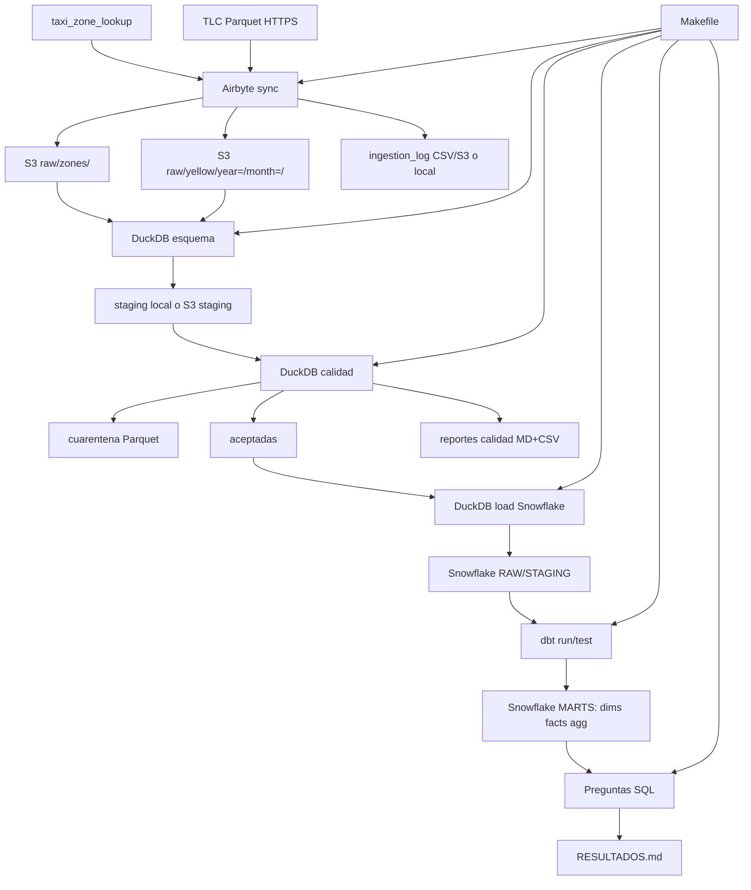

# Plan: Pipeline NYC Taxi (examen) — Airbyte + S3 + DuckDB + Snowflake/dbt

Repo: [`/home/bernadiaz/Escritorio/DataEng/ParcialDataEng`](/home/bernadiaz/Escritorio/DataEng/ParcialDataEng) (vacío hoy). Mes concreto solo como parámetro (`MES=YYYY-MM`); comparación fija = mismo mes 2024. Placeholder en docs: `2025-03` hasta asignación.

## Decisiones fijadas

| Tema | Decisión |
|------|----------|
| Ingesta cloud | **Airbyte** → **AWS S3** (landing raw, estilo Hive) |
| Motor local de control | **DuckDB** (esquema, calidad, cuarentena, reconciliación, carga) |
| Warehouse analítico | **Snowflake** |
| Transformación + modelado | **dbt** sobre Snowflake |
| Empaque | Python 3.12 + `pyproject.toml` + proyecto `dbt/` |
| Orquestación | Solo `Makefile` → `make all MES=YYYY-MM` |
| `cbd_congestion_fee` 2024 | `NULL` |
| Columna nueva no contratada | ignore + warning en reporte de esquema |
| Columna requerida faltante | falla el pipeline |
| Distancia máxima | constante fija post-exploración (candidato 100 mi) |
| Regla extra (R09) | la elegís vos tras exploración |
| IA en git | README declara Cursor; **sin** `Co-authored-by`; commits con tu identidad |
| Alcance meses | solo mes asignado + mismo mes 2024 (código parametrizable) |

## Arquitectura objetivo



### Flujo por `MES=YYYY-MM`

1. **Airbyte** sincroniza yellow del mes + mismo mes 2024 + zonas hacia S3 sin alterar el Parquet fuente; registra control (archivo, URL, bytes, hash, filas metadata, ts, estado).
2. **DuckDB** lee desde S3 (o mirror local), valida contrato de esquema, normaliza snake_case, unifica meses (cbd 2024 = NULL).
3. **DuckDB** aplica 8+ reglas → aceptadas / cuarentena / flags; reportes MD+CSV; falla si no reconcilia conteos.
4. **DuckDB → Snowflake**: carga partición del mes a schemas `RAW`/`STAGING` (replace por mes; idempotente).
5. **dbt (Snowflake)**: transforma (derivados + enrich zonas) y materializa modelo estrella + `agg_zone_hour` con FinOps.
6. Runner ejecuta `q1`…`q6` contra Snowflake/marts y vuelca `RESULTADOS.md`.

## FinOps (obligatorio en diseño dbt/Snowflake)

Prácticas concretas a implementar y documentar en README:

- **Warehouse XS** dedicado al pipeline (`WH_TAXI_DEV` / `WH_TAXI_RUN`), auto-suspend 60s, auto-resume on.
- **Separación de capas**: `RAW` (transient o copy cheap), `STAGING`, `MARTS`; no queries ad-hoc sobre RAW en el warehouse de BI.
- **Materializaciones dbt**:
  - `staging` / `intermediate`: `view` o `ephemeral` donde no haga falta persistir.
  - `fact_trips`: `incremental` filtrado por `year/month` (replace partición lógica del mes) para no full-refresh de histórico.
  - `dim_*`: `table` pequeña o `incremental merge` por clave.
  - `agg_zone_hour`: `table` o incremental por fecha.
- **Tags de costo**: `project=nyc_taxi`, `env=dev|exam`, `owner=<tu_user>` en warehouse y objetos.
- **Evitar**: `SELECT *` en marts finales, warehouses grandes “por las dudas”, full refresh diario, clustering prematuro.
- **Transient tables** en staging intermedio (sin Time Travel costoso si no se necesita).
- **Medición**: anotar en README créditos estimados / tiempo de `dbt run` y tamaño warehouse usado.
- **Secrets**: credenciales AWS/Snowflake/Airbyte solo por env vars o perfiles locales; nunca en git.

## Estructura del repo

```
ParcialDataEng/
  pyproject.toml
  Makefile
  README.md
  RESULTADOS.md
  .gitignore
  contracts/yellow_schema.yaml
  airbyte/
    connections/yellow_to_s3.yaml   # export/doc de conexión
    README_AIRBYTE.md               # pasos UI + sync manual/API
  src/
    __init__.py
    config.py
    duck.py
    ingesta_airbyte.py              # trigger sync / verify S3 + log
    esquema.py
    calidad.py
    load_snowflake.py               # DuckDB -> Snowflake
    resultados.py
  dbt_taxi/
    dbt_project.yml
    profiles.yml.example
    models/
      staging/
      intermediate/
      marts/
        dim_zone.sql
        dim_date.sql
        fact_trips.sql
        agg_zone_hour.sql
    tests/
    macros/
  sql/
    q1_top_zones_variation.sql
    q2_peak_hour_avg_revenue.sql
    q3_cbd_fee_share.sql
    q4_tip_pct_by_payment.sql
    q5_airport_trips.sql
    q6_month_variation.sql
  tests/
    test_quality_rule.py
    test_ingest_idempotency.py
    test_reconciliation.py
  data/                             # gitignored (local cache/cuarentena/reportes)
```

## Implementación por etapa

### 0. Scaffold
- Python 3.12, deps: `duckdb`, `dbt-snowflake`, `pyyaml`, `boto3`, `httpx`/`requests`, `pytest`.
- Makefile: `install`, `airbyte-sync`, `schema`, `quality`, `load-sf`, `dbt-run`, `questions`, `all`, `test`, demos de defensa.
- `make all MES=YYYY-MM` orquesta Airbyte → DuckDB esquema/calidad → load Snowflake → `dbt run --select ...` → preguntas (incluye automáticamente mes 2024).

### 1. Ingesta Airbyte → S3
- Source: archivos TLC (`yellow_tripdata_AAAA-MM.parquet`) + CSV zonas (HTTP o S3 public mirror documentado).
- Destination: bucket S3 propio, paths:
  - `s3://<bucket>/raw/yellow/year=AAAA/month=MM/`
  - `s3://<bucket>/raw/zones/taxi_zone_lookup.csv`
- Idempotencia: Airbyte overwrite/append por path de mes + verificación post-sync (objeto existe, SHA-256 coincide con log).
- Reintentos: política Airbyte + wrapper Makefile que reintenta sync 3 veces (1s, 2s, 4s) si falla el job.
- `ingestion_log` append-only (CSV local `data/control/` y/o objeto en `s3://.../control/`): archivo, URL, filas (metadata), bytes, hash, ts, estado.
- Zonas: sync una sola vez si el objeto ya está y el hash coincide.
- Documentar en `airbyte/README_AIRBYTE.md` cómo recrear la conexión (el examen exige reproducibilidad; el repo versiona la config, no los secretos).

### 2. Esquema (DuckDB)
- Contrato [`contracts/yellow_schema.yaml`](contracts/yellow_schema.yaml): tipos DuckDB explícitos, `required`/`nullable`, `source_aliases`.
- Leer Parquet desde S3 (`httpfs`/`s3` en DuckDB) o cache local.
- snake_case; unificar meses; cbd 2024 → NULL; columnas nuevas → ignore + warning; required faltante → fail.
- Salida staging lista para calidad.

### 3. Calidad y cuarentena (DuckDB)

| ID | Regla | Severidad |
|----|-------|-----------|
| R01 | pickup fuera del mes del archivo | rechazo |
| R02 | dropoff <= pickup | rechazo |
| R03 | distancia <= 0 o > máximo fijo | rechazo |
| R04 | total_amount negativo | rechazo |
| R05 | passenger_count null/0 | advertencia |
| R06 | zona inexistente | rechazo |
| R07 | duplicados exactos | rechazo |
| R08 | propina negativa o > fare | advertencia |
| R09 | regla propia post-exploración | a definir |

- Cuarentena: 1 fila por viaje + source_file + lista de reglas.
- Reportes MD + CSV; reconciliación obligatoria.
- Umbral distancia: explorar P99/P99.9 y fijar constante (candidato **100 millas**), justificar en README.

### 4. Carga DuckDB → Snowflake
- Extensión/conexión Snowflake desde DuckDB (`ATTACH`/connector o stage + `COPY INTO` vía SQL generado).
- Cargar aceptadas (+ zonas) a `RAW.YELLOW_TRIPS` / `STAGING.YELLOW_TRIPS` particionadas lógicamente por `year`, `month`.
- Reprocesar un mes: `DELETE`/`INSERT` o `CREATE OR REPLACE TABLE ... WHERE month=` solo esa partición; no tocar otros meses.
- Persistir también metadatos de carga (filas, ts, mes) para defensa.

### 5. Transformación dbt (Snowflake) + FinOps
- Models `staging`: rename/cast mínimos (views).
- `intermediate`: `duration_min`, `avg_speed_mph`, `pickup_date/hour/dow`, `tip_pct`, enrich `pu_*` / `do_*` via join a zonas.
- Incremental por mes para no reescribir todo el histórico.
- Tests dbt básicos (`not_null`, `accepted_values`, relaciones) además de la calidad DuckDB previa.
- Warehouse XS + tags + transient en intermedios.

### 6. Modelado dbt (estrella)
- `dim_zone`, `dim_date` (calendario `generate_series`/dbt utils para meses procesados), `fact_trips`, `agg_zone_hour`.
- Granularidad documentada en README y `dbt docs` (descripción de modelos).
- Rebuild idempotente: `dbt run` completo o selectivo por mes según strategy incremental.

### 7. Preguntas de negocio
- SQL en `sql/q*.sql` contra marts Snowflake (o `analyses/` dbt).
- `src.resultados` escribe `RESULTADOS.md`; interpretaciones las escribís vos.
- q4: payment type no interpretable (cash / no charge / dispute).

### 8. Tests y defensa
- pytest: regla sintética, idempotencia de sync/carga (mock), reconciliación.
- `make demo-idempotency`, `make show-quarantine`, `make quality-report`.

### 9. Documentación
- Install, credenciales necesarias (AWS, Snowflake, Airbyte), `make all`, arquitectura, decisiones de calidad, **FinOps**, limitaciones, tiempo/créditos, declaración de IA.
- Git sin Cursor como colaborador.

## Orden de trabajo (hasta 19/11)

1. Scaffold + contrato + Makefile + skeletons Airbyte/dbt.
2. Airbyte → S3 + log + verify hash.
3. DuckDB esquema + calidad + reportes + tests locales.
4. Exploración umbral distancia + elegir R09.
5. Load DuckDB → Snowflake (idempotente por mes).
6. dbt staging/intermediate/marts + FinOps config.
7. q1–q6 + RESULTADOS.md.
8. Demos defensa + README (IA + costos).
9. Corrida oral-ready con mes asignado.

## Fuera de alcance

- Pipeline “todos los meses” (solo param).
- Airflow/Prefect/PySpark.
- Materializar marts de vuelta a Parquet local (el mart vive en Snowflake).
- `run.sh` o CLI único monolítico.
- Commits/Co-authored-by de Cursor.
