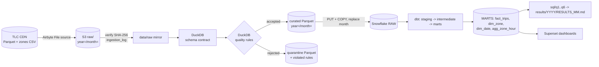

# NYC Taxi Pipeline: a month against the same month of the previous year

A reproducible batch **ELT** pipeline for the NYC TLC yellow taxi trip records. It ingests,
validates, cleans and models two months (the assigned month and the same month of the previous
year), then answers six business questions on its own dimensional model.

```
Airbyte -> AWS S3 (raw, Hive layout) -> DuckDB quality gate -> Snowflake RAW <- dbt (staging, marts)
              orchestrated by Dagster, one command: make all MES=2025-01
              observed with Prometheus + Grafana, Loki (Alloy) and Dozzle; dashboards in Superset
```

The month is a parameter everywhere. `MES=2025-01` processes 2025-01 and 2024-01, and `MES` can be any
month from **2010-01** (compared with 2009-01, the first TLC Parquet file) to the last month the TLC has
published (2026-09 when this was written). Every run writes its report, in Spanish, to
**`results/YYYY/RESULTS_MM.md`** (YYYY and MM = the year and month of `MES`), the complete report of the
two months. The comparison is always month against month, never a month against a whole year:
- [`results/2025/`](results/2025): the twelve months of **2025, each one against the same month of 2024**
  (`make all MES=2025-01` → `RESULTS_01.md`, January 2025 vs January 2024, up to `MES=2025-12` →
  `RESULTS_12.md`);
- [`results/2026/`](results/2026): the months of **2026 the TLC has published (January to September),
  each one against the same month of 2025** (`make all MES=2026-01` → `RESULTS_01.md`, ...).

Each report is interpreted from its own numbers.

---

## Contents

1. [Quick start](#1-quick-start)
2. [Architecture](#2-architecture)
3. [Repository layout](#3-repository-layout)
4. [Configuration and credentials](#4-configuration-and-credentials)
5. [Part 1: Ingestion](#5-part-1-ingestion-airbyte---s3)
6. [Part 2: Schema contract](#6-part-2-schema-contract)
7. [Part 3: Data quality and quarantine](#7-part-3-data-quality-and-quarantine)
8. [Part 4: Curated layer and reprocessing](#8-part-4-curated-layer-and-reprocessing)
9. [Part 5: Dimensional model and business questions](#9-part-5-dimensional-model-and-business-questions)
   - [Results of the last run](#results-of-the-last-run)
10. [Orchestration (Dagster)](#10-orchestration-dagster)
11. [Observability (Prometheus, Grafana, Loki, Dozzle)](#11-observability)
12. [Dashboards (Superset)](#12-dashboards-superset)
13. [FinOps (Snowflake and dbt)](#13-finops-snowflake-and-dbt)
14. [Tests](#14-tests)
15. [Runtime and peak RAM](#15-runtime-and-peak-ram)
16. [Oral defense script](#16-oral-defense-script)
17. [Known limitations](#17-known-limitations)
18. [AI usage statement](#18-ai-usage-statement)

---

## 1. Quick start

Requirements: Docker (Docker Desktop on Windows and macOS, Docker Engine with the Compose plugin on
Linux), plus Python 3.12+ and GNU make (on Windows run it from Git Bash). Without Python and make,
the `pipeline` container runs the same commands (see [Only Docker](#only-docker-no-make-or-python)
below). The cloud mode also needs an AWS account with an S3 bucket, a Snowflake account and Airbyte
(`abctl`).

```bash
git clone https://github.com/bernadiaz/ParcialDataEng.git && cd ParcialDataEng
cp .env.example .env              # fill in the values (section 4)
docker compose up -d              # Dagster UI, Grafana, Prometheus, Pushgateway, Loki, Alloy, Dozzle, Superset
make all MES=2025-01              # cloud mode: the whole pipeline for 2025-01 and 2024-01
```

**Without cloud accounts** (graders, CI, laptop on a plane): the same pipeline runs end to end
locally. Ingestion downloads the files from the TLC CDN (S3 is skipped), and the warehouse is a local
DuckDB file that dbt, the questions and Superset use instead of Snowflake:

```bash
docker compose up -d
make all MES=2025-01 INGEST_MODE=direct WAREHOUSE=duckdb
```

Those two commands are the whole run, on Windows, Linux and macOS. `make all`:
- creates `.venv` and installs the project the first time, with the first Python 3.12+ it finds
  (`make install` is optional, and it runs again by itself when `pyproject.toml` changes);
- runs every step through Dagster: ingestion, schema, quality, load, dbt, the six questions
  (`results/YYYY/RESULTS_MM.md`) and the **Superset dashboards**, so no other
  command is needed;
- writes the Dagster run history to the Postgres of docker compose, so the lineage at
  http://localhost:3003 shows every asset green as the runs finish.

In cloud mode, if Airbyte is stopped (for example after a reboot), the pipeline starts abctl's
container and waits for it. If Airbyte still does not answer, the zone lookup is downloaded from the
TLC and uploaded unmodified to the same S3 prefix (`AIRBYTE_FALLBACK=direct`, logged as
`mode=direct`).

### Only Docker (no make or Python)

`docker compose up -d` also starts the `pipeline` container, built from the [`Dockerfile`](Dockerfile):
Python 3.12, GNU make, git, curl, openssl and every library of [`requirements.txt`](requirements.txt),
at the versions the pipeline was validated with. Run the same `make` targets inside it, on Windows
(PowerShell, CMD or Git Bash), Linux or macOS:

```bash
git clone https://github.com/bernadiaz/ParcialDataEng.git && cd ParcialDataEng
cp .env.example .env              # fill in the values (section 4)
docker compose up -d
docker compose exec pipeline make all MES=2025-01                                        # cloud
docker compose exec pipeline make all MES=2025-01 INGEST_MODE=direct WAREHOUSE=duckdb    # offline
```

Both ways share everything: the same `.env`, `DATA_DIR`, Snowflake key and AWS profile, so they write
the same data, Dagster run history, logs, metrics and dashboards. Inside the container,
[`docker/pipeline-make.sh`](docker/pipeline-make.sh) runs `make` with these adjustments:
- `DATA_DIR` is mounted at `/data`. Postgres, Superset and the Pushgateway are reached by their
  service names, and Airbyte (abctl, on the host) through `host.docker.internal`.
- The Snowflake key is read from `SNOWFLAKE_KEYS_DIR` (mounted at `/keys`), so keep the key file in
  that folder. make uses a private copy of it (permissions 0600): Docker Desktop shows files mounted
  from Windows as writable by everyone, and the Snowflake connector refuses such a key. The AWS
  profile comes from `~/.aws` (`AWS_CONFIG_DIR` in `.env` changes it).
- On Linux, make runs as the owner of the repository, so no file ends up owned by root.
- The libraries live in the image (`/opt/venv`), never in the repository's `.venv`.
  `docker compose up -d` rebuilds the image when `requirements.txt` changes.
- dbt writes its artifacts to `/opt/dbt` in the container, not to `dbt_taxi/target`: a partial parse
  written on Linux holds Linux paths, and dbt on a Windows host fails to read it.

Two differences with the host: the container cannot start a stopped Airbyte (start it with
`docker start airbyte-abctl-control-plane`, or the zone lookup takes the direct path), and DuckDB gets
a quarter of the container's memory limit (`PIPELINE_MEM_LIMIT`, 4g by default). `make status` and
`make up` check the host, so run them on the host or use `docker compose ps`.

| UI | URL | What |
|---|---|---|
| Dagster | http://localhost:3003 | asset lineage, monthly partitions, runs, reconciliation check (read only: runs start from `make all`) |
| Grafana | http://localhost:3002 | *Pipeline Health & Logs*, *Data Quality* |
| Superset | http://localhost:8090 | 7 dashboards in English (6 business + Data Quality & Quarantine), built by `make all` |
| Dozzle | http://localhost:8081 | live container logs |
| Prometheus | http://localhost:9090 | metrics (from the Pushgateway, :9091) |

Ports bind to `127.0.0.1` and avoid 3000/3001/8088/8089, which other local stacks often use. The
Dagster Postgres listens on `127.0.0.1:5434` (not 5432/5433, which a local PostgreSQL usually takes;
`DAGSTER_PG_PORT` in `.env` changes it).

**If a UI says "This site can't be reached"**, run `make status`. It checks every container and its
page, and says why one fails and how to fix it:
- the port is taken by another program, or reserved by Windows (Hyper-V/WSL reserve port ranges:
  `netsh interface ipv4 show excludedportrange protocol=tcp`). Every host port can be changed in
  `.env` (`GRAFANA_PORT`, `SUPERSET_PORT`, `DAGSTER_UI_PORT`, `PROMETHEUS_PORT`,
  `PUSHGATEWAY_PORT`, `LOKI_PORT`, `ALLOY_PORT`, `DOZZLE_PORT`); then run `docker compose up -d`
  again;
- the container stopped or ran out of memory: its last log lines are shown;
- the container keeps restarting before its page answers: it is reported as "keeps restarting", with
  its last log lines, instead of "starting" forever;
- it is still starting (Superset needs 1-2 minutes the first time).

**If Dagster stays "starting" after `make all`** (it happened on a second Windows laptop), update the
repository (`git pull`) and run `docker compose up -d`. The cause was a restart loop in the Dagster UI
container. `dagster-webserver` reads the `.env` of its working directory, and its values replace the
settings of the container. So the `DAGSTER_PG_PORT` of the host (5434 by default, or 5436 on that
laptop) replaced the 5432 of the container. The UI looked for its Postgres on the wrong port, gave up
after about 30 seconds, and Docker started it again. The pipeline itself was fine: the runs were
saved, and the UI was the only thing down. The UI now runs from `DAGSTER_HOME`, which has no `.env`,
so the settings of `docker-compose.yml` always win.

`make up` runs `docker compose up -d --build` and then waits until every UI answers, or prints the
same diagnosis. No service waits for another to start (only Dagster waits for its Postgres). A
port conflict in Prometheus or Loki used to leave Grafana stuck in "Created", because of a
`depends_on` that Grafana did not need. That is why Grafana could fail on one computer and work on
another.

---

## 2. Architecture



Every row read ends in **curated** or in **quarantine**. The invariant
`rows read = accepted + quarantined` is checked on every run, and the run fails when it does not hold.

| Layer | Where | Written by |
|---|---|---|
| Raw (bronze) | `s3://<bucket>/raw/yellow/year=YYYY/month=MM/`, mirrored in `data/raw/` | Airbyte + `src/ingesta_airbyte.py` |
| Curated + quarantine (silver) | `data/curated/yellow/year=/month=/`, `data/quarantine/...` | `src/calidad.py` (DuckDB) |
| Warehouse RAW | `NYC_TAXI.RAW.YELLOW_TRIPS`, `TAXI_ZONES`, `LOAD_LOG` | `src/load_snowflake.py` |
| Staging / marts (gold) | `NYC_TAXI.STAGING` (views), `NYC_TAXI.MARTS` (tables) | dbt (`dbt_taxi/`) |

Why each tool:
- **DuckDB** is the local quality gate. It needs no cluster, handles 3.5M rows in seconds and uses
  about 1.3 GB of RAM.
- **Snowflake + dbt** build the analytical model, with tests, lineage and cost controls.
- **Airbyte** owns the cloud landing.
- **Dagster** gives partitions per month, run history and asset checks.
- **Make** stays the single entry point.

---

## 3. Repository layout

```
contracts/          yellow_schema.yaml, taxi_zone_schema.yaml, quality_rules.yaml (versioned, not in code)
airbyte/            connections/*.yaml (versioned Airbyte config, no secrets) + README_AIRBYTE.md
src/                config, ingesta_airbyte, esquema, calidad, load_snowflake, resultados,
                    interpretacion (Spanish interpretations written from the numbers of each run),
                    orchestration (Dagster), dagster_instance (shared run history), dashboards
                    (Superset as code), observability, exploracion, demos, clean
dbt_taxi/           dbt project: staging (views), intermediate (ephemeral), marts, tests, macros
sql/                q1..q6 (one query per file) + contexto/ (context queries the interpretations use)
results/            2025/ and 2026/: RESULTS_MM.md, one Spanish report per month (MES vs the same month a year before)
snowflake/          setup.sql (warehouses, monitor, schemas, tags, role) + finops.sql
observability/      prometheus.yml, alloy/config.alloy, grafana provisioning + dashboards
superset/           Dockerfile, config, first-start script
dagster/            Dockerfile + supervisor of the Dagster UI container (reloads it when the code changes)
docker/             pipeline-make.sh: `make` of the pipeline container (adapts .env to the container)
Dockerfile          pipeline container: Python 3.12, GNU make and requirements.txt (runs make without installing it)
requirements.txt    every library of the pipeline, pinned to the validated versions (pip install -r requirements.txt)
tests/              pytest: quality rules, idempotency, reconciliation, schema, two-command run
docs/               Spanish project documentation (Documentacion_Pipeline_NYC_Taxi.docx)
docker-compose.yml  Dagster UI + its Postgres, observability and BI stack, and the pipeline container
Makefile            the only command you need
```

`data/` (or `DATA_DIR`) holds raw mirrors, curated, quarantine, reports, logs and the control
database. It also holds Superset's metadata (`superset_home`) and, without Docker, Dagster's run
history (`dagster_home`). It is gitignored. `make clean` empties it, wipes the Dagster history and
keeps `superset_home`, so the dashboards are not lost. On Linux, the one-shot `data-dirs` service of
docker compose creates the folders that the containers mount, owned by your user. Otherwise Docker
would create them as root, and `make all` could not write to `DATA_DIR`.

---

## 4. Configuration and credentials

Everything is read from **`.env`** (gitignored). The template is [`.env.example`](.env.example).
No credential is ever written in the code or in versioned files.

Paths in `.env` are portable, so the same file works on Windows, Linux and macOS:
- `~` is the user's home folder;
- a relative path is relative to the repository.

`src/config.py` resolves them once, before dbt, Dagster or the Snowflake connector start, and
docker compose expands `~` in its volumes. For example, `DATA_DIR=~/nyc_taxi_data` and
`SNOWFLAKE_PRIVATE_KEY_PATH=~/.snowflake/taxi_svc.p8`.

| Variable | Purpose |
|---|---|
| `WAREHOUSE` | `snowflake` (default) or `duckdb` (offline) |
| `INGEST_MODE` | `hybrid` (template: Airbyte for the zones, months streamed to S3), `airbyte` or `direct` (TLC CDN). `direct` + `WAREHOUSE=duckdb` is the offline mode and skips S3 |
| `DATA_DIR` | local data folder (default `./data`). Keep it out of OneDrive/Dropbox/iCloud, because sync clients lock DuckDB files |
| `DAGSTER_PG_*`, `DAGSTER_STORAGE` | Postgres of docker compose that holds the Dagster run history (port 5434 by default). Without Docker the history falls back to SQLite in `DATA_DIR/dagster_home` |
| `AIRBYTE_FALLBACK` | `direct` (default): if Airbyte does not answer, download from the TLC to the same S3 prefix. `fail` stops the run |
| `AWS_PROFILE`, `AWS_REGION`, `S3_BUCKET` | AWS profile (AWS Toolkit / `aws configure`); keys stay in `~/.aws` |
| `AIRBYTE_*` | API URL, client id/secret (`abctl local credentials`), workspace, S3 keys for the destination |
| `SNOWFLAKE_*` | account, service user `TAXI_SVC` with a key pair (`SNOWFLAKE_PRIVATE_KEY_PATH`), role, warehouse, database. `externalbrowser` is supported, but it only works on accounts with a SAML identity provider |
| `COST_ENV`, `COST_OWNER` | FinOps query tags |
| `GRAFANA_*`, `SUPERSET_*` | local admin passwords and the Superset service user key file |

**Snowflake, once:** run [`snowflake/setup.sql`](snowflake/setup.sql) in a Snowsight worksheet as
`ACCOUNTADMIN` **before the first load**. It creates:
- the `WH_TAXI_DEV` and `WH_TAXI_RUN` warehouses;
- the `RM_TAXI` resource monitor;
- the database with its `RAW`, `STAGING` and `MARTS` schemas;
- the cost tags;
- the `TAXI_PIPELINE` role, granted to your user;
- the **`TAXI_SVC` service user**, with a key pair.

Generate the key with `openssl` (the commands are in step 7 of the script) and paste the public key
before running that step. The loader, dbt, the questions and Superset all connect as `TAXI_SVC`.
The private key stays in `~/.snowflake`, outside the repo.

---

## 5. Part 1: Ingestion (Airbyte -> S3)

`make airbyte-sync MES=2025-01` (`src/ingesta_airbyte.py`) handles each dataset and month (and the
zone lookup once). Airbyte details are in [airbyte/README_AIRBYTE.md](airbyte/README_AIRBYTE.md).

The Airbyte objects are created **automatically** from the versioned YAML the first time they are
needed: a source, an S3 destination and a manual connection for each dataset that goes through
Airbyte (with `hybrid`, only the zone lookup). The setup is idempotent (objects are reused by name)
and survives the slow schema discovery of the File source.

1. **Skips** when the last successful `ingestion_log` entries still match the local mirror
   (SHA-256) and S3 (size + ETag). A second run neither syncs nor downloads, and it logs
   `action=skipped`.
2. **Parametrizes** the versioned connection: the source URL `yellow_tripdata_{mes}.parquet` and
   the destination path `raw/yellow/year={year}/month={month}`.
3. **Retries** network failures (the download, or calls to the Airbyte API) **3 times, waiting 1 s,
   2 s and 4 s**. If they still fail, it logs `status=error` and **exits with code 1**. A 404 (month
   not published yet) fails immediately. An Airbyte job that fails is not started again, because
   Airbyte already retried its attempts. A job still running after `AIRBYTE_SYNC_TIMEOUT_MINUTES` (30)
   is cancelled. Either way the failure is logged, and the same file lands at the same S3 prefix by
   the direct path (`AIRBYTE_FALLBACK=direct`; `fail` stops the run instead).
4. **Verifies** the result:
   - removes leftovers of older syncs under the month prefix;
   - downloads each object to `data/raw/...` computing SHA-256, with an atomic rename so no file
     is left half written;
   - checks the Parquet row count against the job's `rowsSynced`.

`ingestion_log` (control database) has one row per file: run id, dataset, month, file, URL, S3
URI, bytes, SHA-256, rows (Parquet metadata), ETag, mode, action, Airbyte job id, attempts,
status, error and timestamp.

There are three ingestion modes:
- **`INGEST_MODE=hybrid`** (recommended and used for the delivered run) keeps Airbyte for the zone
  lookup and uses the direct path for the monthly files.
- **`INGEST_MODE=direct`** is the fallback without Airbyte. It downloads the same files from the CDN
  with the same retries, hash and log, and uploads them unmodified to the same S3 path when
  `S3_BUCKET` is set.
- **`INGEST_MODE=airbyte`** sends everything through Airbyte.

Why `hybrid` for the monthly Parquet: Airbyte's File source cannot ingest it.
- It loads the whole month into pandas, and builds one Python dict per row, before it emits the
  first record, so the connection sits in "Syncing" at 0 rows. It needs more than 4Gi per job pod;
  with 7Gi it no longer runs out of memory.
- Even then, every attempt fails with `Object of type Timestamp is not JSON serializable`. Reproduced
  on 2026-11-15 with `source-file` 0.6.0 (0.6.2 is the same): about 6 minutes at 0 rows per attempt,
  times 3 attempts. No setting fixes it, and the TLC's public S3 bucket answers 403, so only the CDN
  serves the files.
- So in hybrid mode the yellow connection is not created. If an earlier version created it, and a
  sync started from the UI stays in "Syncing", `make airbyte-cancel` stops it and
  `make airbyte-prune` removes the unused connection.

The test and the settings are in [airbyte/README_AIRBYTE.md](airbyte/README_AIRBYTE.md).

---

## 6. Part 2: Schema contract

[`contracts/yellow_schema.yaml`](contracts/yellow_schema.yaml) declares every target column with its
DuckDB type, `required`, `nullable`, `source_aliases` and the description from the TLC data
dictionary (March 18, 2025). Before anything is loaded, `src/esquema.py` compares each raw file
with the contract and writes `data/reports/schema/schema_report_yellow_<mes>.md/.json` and a row
in the control table.

- **snake_case:** a generic function plus explicit aliases. For example, `PULocationID` becomes
  `pu_location_id`, and `Airport_fee` (the file really uses a capital A) becomes `airport_fee`.
- **Both months, one table:** each month is read with the contract's names and types, so the
  curated dataset (and `RAW.YELLOW_TRIPS`) holds both with an identical schema.
- **Decision: `cbd_congestion_fee` in 2024 = NULL.** The charge did not exist before Jan 5, 2025.
  0 would mean "the trip paid no congestion fee" and would mix that with "the fee did not exist".
  The column is declared `required: false`, so it is filled with NULL when absent.
- **A required column is missing** (e.g. `trip_distance`): the run fails before loading. The
  schema report shows it.
- **A new column not in the contract** (e.g. a future `surge_fee`): it is ignored and reported as a
  warning (report, log, Grafana). The raw file keeps it untouched, so adopting it later is a contract
  change plus a reprocess. Airbyte metadata (`_airbyte_*`) is ignored on purpose.
- **A type differs from the contract:** the value is `TRY_CAST` to the contract type, and the
  report counts the values that could not be cast. This is expected with Airbyte, which can deliver
  `passenger_count` as double or timestamps as text.

**Every TLC file since 2009.** The TLC publishes yellow trip records as Parquet from January 2009,
and the files did not always look like today's. The contract absorbs each change, so `MES` can be any
month from 2010-01 on (it is compared with the same month of the previous year):

| Files | What is different | What the pipeline does |
|---|---|---|
| 2009 | `vendor_name`, `Trip_Pickup_DateTime`, `Fare_Amt`, `Tip_Amt`...; payment as text (`CASH`, `Credit`, `No Charge`); **no zone ids, only coordinates** (`Start_Lon`, `Start_Lat`, `End_Lon`, `End_Lat`) | `source_aliases` map the names; `value_map` turns the text codes into today's codes; the zone ids are **derived** by placing each point inside the official TLC taxi zone polygons (`taxi_zones.zip`, DuckDB spatial) |
| 2010 | `pickup_datetime`, `rate_code`, `surcharge`...; vendor and payment as text (`VTS`, `Cas`, `Cre`); coordinates instead of zone ids | the same; `surcharge` is today's `extra` |
| 2011-2018 | today's names; `airport_fee` and `congestion_surcharge` stored as INT32 (always NULL) | cast to DOUBLE (reported as a type difference, no value lost) |
| 2019-2023 | `passenger_count` and `RatecodeID` stored as DOUBLE | cast to BIGINT |
| 2024 | no `cbd_congestion_fee` | NULL, not 0 (above) |
| 2026-09 on | a new column, `request_source` | ignored and reported (new column) |

Coordinates that cannot be a place (missing or 0) get zone **264 (Unknown)** and real coordinates
outside every zone (New Jersey, water) get **265 (Outside of NYC)**, the ids the TLC itself uses for
trips without a zone. The schema report counts both, and DDS, a 2009-2010 vendor with no numeric code
today, stays NULL and is counted as a value that could not be cast. Before anything runs, `make all`
checks that the two months exist: older than 2009-01, in the future or not published yet (the TLC CDN
answers 403 with an XML "AccessDenied" for a file that does not exist), it stops at once and says why.
A 403 page from CloudFront itself (HTML "The request could not be satisfied") is not "not published":
the CDN throttles an address for a few minutes after too many requests, and the ingestion says to wait
and run again (the months already downloaded are not downloaded twice).

---

## 7. Part 3: Data quality and quarantine

Rules live in [`contracts/quality_rules.yaml`](contracts/quality_rules.yaml): id, description,
severity, threshold, rationale and the SQL predicate. `src/calidad.py` turns them into **one DuckDB
pass**. Rule counts below are rows violating each rule; a row can violate several.

| Rule | Description | Severity | Threshold | 2024-01 | 2025-01 |
|---|---|---|---|---:|---:|
| R01 | Pickup outside the file's month | reject | year/month ≠ `--mes` | 18 | 22 |
| R02 | Dropoff ≤ pickup | reject | duration ≤ 0 s | 870 | 2,051 |
| R03 | Distance ≤ 0 or > max | reject | 100 miles | 60,430 | 91,055 |
| R04 | Negative (or missing) total amount | reject | `total_amount < 0` | 35,504 | 63,037 |
| R05 | Passenger count NULL or 0 | **warning** | NULL or 0 | 171,627 | 564,805 |
| R06 | Zone not in the lookup | reject | id ∉ zones | 0 | 0 |
| R07 | Exact duplicate (2nd+ copy) | reject | all contract columns equal | 0 | 0 |
| R08 | Tip negative or greater than the fare | warning | `tip < 0 or tip > fare` | 41,402 | 148,413 |
| R09 | **Own rule:** average speed above max | reject | 80 mph | 1,107 | 982 |
| R10 | **Own rule:** CBD fee negative or charged before Jan 5, 2025 | warning | fee < 0, or > 0 before the start | 0 | 6,954 |

| | 2024-01 | 2025-01 |
|---|---:|---:|
| Rows read | 2,964,624 | 3,475,226 |
| Accepted (curated) | 2,870,896 (96.84%) | 3,323,437 (95.63%) |
| Quarantined | 93,728 (3.16%) | 151,789 (4.37%) |
| Accepted with warning flags | 150,746 | 511,679 |
| Reconciled (read = accepted + quarantined) | yes | yes |

**Thresholds and severities** (from `make explore`; full reasoning in the YAML):
- **R03 = 100 miles.** p99 is 20 miles and p99.9 is about 29 miles; the maximum observed is
  312,722 miles. 100 miles leaves room for negotiated out-of-city trips (rate codes 4/5).
- **R05 is a warning, not a reject.** Every Flex Fare trip (`payment_type = 0`) has NULL passenger
  count, rate code and store-and-forward flag. That is 4.7% of 2024-01 but **15.5% of 2025-01**.
  Rejecting them would bias every year-over-year comparison, and no business question uses passengers.
- **R09 (own rule) = 80 mph.** It was found while exploring: trips of a few seconds with several
  miles. Either the timestamps or the distance are wrong.
- **R10 (own rule).** It comes from the 2025 schema change: 6,553 trips have a −0.75 fee
  (reversals) and 401 were charged before the toll existed. It is a warning because a trip that
  starts before midnight can enter the zone after the toll starts.
- **R07 keeps the first copy** as accepted and quarantines the rest. The rule finds no duplicates in
  these files, and a synthetic test proves it works.

**Quarantine:** every rejected row is kept, never dropped, in three places that `make all`
updates on every run, month by month:

| Where | What |
|---|---|
| `DATA_DIR/quarantine/yellow/year=YYYY/month=MM/part-0.parquet` | One row per rejected trip: the contract columns as read, `source_file`, `source_row_number` (points to the untouched raw row), `violated_rules` (for example `R03;R04`), `warning_flags`, `run_id`, `quarantined_at`. |
| Warehouse table `RAW.YELLOW_QUARANTINE` (Snowflake), `raw.yellow_quarantine` (DuckDB) | The same rows, loaded like the trips: the month is deleted and reloaded in one transaction, with the count checked and a row in `LOAD_LOG`. dbt reads it as a source and builds `marts.agg_quarantine_rule` (rows per month and rule). |
| `s3://<bucket>/quarantine/yellow/year=YYYY/month=MM/part-0.parquet` (cloud mode) | The quarantine file in the lake, next to `raw/`. The month's prefix is replaced on every run. |

Dagster shows it as the asset `raw/yellow_quarantine`, with its rows per rule, local file and S3
URI. Superset shows it in the **Data Quality & Quarantine** dashboard, which has the rules table, the
reconciliation, the rows per rule and the quarantined rows with their violated rules. Warnings never
drop a row; they go into the `quality_flags` column of the curated data.

| | 2024-01 | 2025-01 |
|---|---:|---:|
| `RAW.YELLOW_QUARANTINE` rows | 93,728 | 151,789 |
| + `fact_trips` rows (accepted) | 2,870,896 | 3,323,437 |
| = rows read | 2,964,624 | 3,475,226 |

**Reports:** `data/reports/quality/quality_report_<mes>.md` and `.csv` (rows read, accepted,
quarantined and count per rule), plus the control tables and the Grafana *Data Quality* dashboard.

**Reconciliation:** curated and quarantine are written to temporary folders and recounted. If
`read ≠ accepted + quarantined` the step raises, exits with code 1, and the published partition
stays as it was. Dagster shows it as the failed asset check `curated_yellow_trips/reconciliation`.

**Handling of NULLs:**
- A predicate that evaluates to NULL counts as "not violated", so each rule handles NULLs
  explicitly. For example, R01 treats a NULL pickup as a violation.
- Values that fail `TRY_CAST` become NULL and are caught by the rules.
- `tip_pct` is NULL when `fare_amount ≤ 0`.
- `avg_speed_mph` is NULL when the duration is 0.

---

## 8. Part 4: Curated layer and reprocessing

- **Partitioned Parquet (Hive style):** `data/curated/yellow/year=YYYY/month=MM/part-0.parquet`
  (ZSTD), with the contract columns, lineage and `quality_flags`.
- **Derived columns** are computed in dbt (`int_trips_enriched`):
  - `duration_min`, `avg_speed_mph`;
  - `pickup_date`, `pickup_hour`, `pickup_dow` (ISO day of week);
  - `tip_pct` (tip as % of fare).
- **Enrichment:** `pu_borough`, `pu_zone`, `do_borough` and `do_zone` come from joining the zone
  lookup twice.
- **Reprocessing a month replaces only that partition:**
  - Locally, the new partition is written to `month=MM.tmp/` and swapped in only after it
    reconciles.
  - In Snowflake, `DELETE WHERE year/month` + `COPY INTO` run in **one transaction**, which rolls
    back if the loaded rows differ from the curated count.
  - In dbt, `fact_trips` and `agg_zone_hour` are incremental: a pre-hook deletes the months in
    `DBT_MONTHS` and the run appends them again.
  - dbt's `delete+insert` strategy with `unique_key=(year, month)` is not used on purpose. That key
    is not unique, so its `DELETE ... USING` joins millions of rows against millions. The demo below
    caught it.

**Demonstration** (`make demo-idempotency MES=2025-01`, offline mode on the author's machine). It
counts every layer, runs the whole pipeline again through Dagster and counts again:

| layer / partition | before rerun | after rerun | status |
|---|---:|---:|---|
| curated 2024-01 | 2,870,896 | 2,870,896 | unchanged |
| curated 2025-01 | 3,323,437 | 3,323,437 | unchanged |
| quarantine 2024-01 | 93,728 | 93,728 | unchanged |
| quarantine 2025-01 | 151,789 | 151,789 | unchanged |
| warehouse marts.agg_zone_hour (sum trips) 2024-01 | 2,870,896 | 2,870,896 | unchanged |
| warehouse marts.agg_zone_hour (sum trips) 2025-01 | 3,323,437 | 3,323,437 | unchanged |
| warehouse marts.fact_trips 2024-01 | 2,870,896 | 2,870,896 | unchanged |
| warehouse marts.fact_trips 2025-01 | 3,323,437 | 3,323,437 | unchanged |
| warehouse raw.yellow_trips 2024-01 | 2,870,896 | 2,870,896 | unchanged |
| warehouse raw.yellow_trips 2025-01 | 3,323,437 | 3,323,437 | unchanged |

The raw files were not downloaded again (`action=skipped`, same SHA-256), and the warehouse load
reports `rows_replaced` equal to `rows_loaded` for each month. That means the month was replaced,
not appended.

---

## 9. Part 5: Dimensional model and business questions

**Star schema** (dbt, schema `MARTS`):

| Table | Grain | Notes |
|---|---|---|
| `fact_trips` | one row per **accepted trip** (one row of RAW) | key `trip_key` = md5(source_file#row); FKs `pickup_date` → `dim_date`, `pu_location_id`/`do_location_id` → `dim_zone` (role-playing); measures in USD, miles, minutes; incremental by (year, month) |
| `dim_zone` | one row per **TLC LocationID** (265) | names are not unique (Corona = 56 and 57), so queries group by id; `is_airport` |
| `dim_date` | one row per **calendar day of each processed month** | ISO day of week, day name, weekend flag, `year_month` |
| `agg_zone_hour` | one row per **pickup zone × pickup date × pickup hour** with trips | trips, total revenue (sum of `total_amount`), average duration; incremental by (year, month) |

dbt runs tests on every build (34 in total):
- `unique` and `not_null` on the keys;
- `relationships` from the fact to both dimensions;
- `accepted_values` for `payment_type`;
- two singular reconciliations: `fact_trips` = RAW per month, and `agg_zone_hour` adds up to
  `fact_trips` with a unique grain.

**Questions:** `sql/q1..q6` (one query per file), run by `make questions` (and by `make all`) into
**`results/YYYY/RESULTS_MM.md`**, one file per month: `make all MES=2025-02` writes
`results/2025/RESULTS_02.md` with February 2025 against February 2024, in local mode
(`INGEST_MODE=direct WAREHOUSE=duckdb`) and in cloud mode alike, and `make all MES=2026-02` writes
`results/2026/RESULTS_02.md` with February 2026 against February 2025. A rerun of the same `MES` replaces
its file. There is no separate RESULTADOS.md: each report is the complete report of its two months, and
the results block below shows the last run.

Each report has, in Spanish:
- a one-line summary and the command, mode, engine, source files and run id that produced it;
- **data quality and quarantine**: rows in each Parquet file, rows read, accepted and quarantined
  (with the reconciliation `read = accepted + quarantined`), every rule with its rows in both months,
  what drives the quarantine and what changed, and what each file brought compared with the contract
  (missing columns, new columns, retyped columns, values that could not be cast, legacy formats);
- the six questions, each with its query, its table and its **interpretation**;
- conclusions.

**The interpretations are not static text.** `src/interpretacion.py` writes every sentence from the
numbers of the run: the six questions, the context queries of [`sql/contexto/`](sql/contexto) (month
profile, zones, hours, calendar, CBD toll per day, payments, airports, fares above US$ 500) and the
schema and quality reports of the control database. It decides, for example, whether a zone "grows" or
"stays", which weekdays a month has five times and what the change would be with the other month's
calendar, whether the CBD toll did not exist yet, started during the month or can be compared, and
whether a single fare above US$ 500 is what moves an average (then it names the trip and gives the
figure without it). If the control database has no quality report for a month (for example
`make questions` against Snowflake from another computer), the counts come from the warehouse
(`fact_trips` and `RAW.YELLOW_QUARANTINE`) and the report says so.

### Results of the last run

<!-- RESULTADOS:START - generated by `make questions` from sql/q*.sql and src/interpretacion.py; do not edit by hand -->

Assigned month **2026-09** vs **2025-09**, from the dbt marts in DuckDB (offline validation target) (`make all MES=2026-09 INGEST_MODE=direct WAREHOUSE=duckdb`, run `20261118T045143Z-2dc8eb`, 2026-11-18). The full report, with the SQL and the data quality and quarantine section, is [results/2026/RESULTS_09.md](results/2026/RESULTS_09.md). The interpretations are in Spanish and are written by `src/interpretacion.py` from the numbers of the run.

One report per month, always against the same month of the previous year (`make all MES=YYYY-MM` writes `results/YYYY/RESULTS_MM.md`):

- **2025**: [RESULTS_01.md](results/2025/RESULTS_01.md) (enero 2025 vs enero 2024), [RESULTS_02.md](results/2025/RESULTS_02.md) (febrero 2025 vs febrero 2024), [RESULTS_03.md](results/2025/RESULTS_03.md) (marzo 2025 vs marzo 2024), [RESULTS_04.md](results/2025/RESULTS_04.md) (abril 2025 vs abril 2024), [RESULTS_05.md](results/2025/RESULTS_05.md) (mayo 2025 vs mayo 2024), [RESULTS_06.md](results/2025/RESULTS_06.md) (junio 2025 vs junio 2024), [RESULTS_07.md](results/2025/RESULTS_07.md) (julio 2025 vs julio 2024), [RESULTS_08.md](results/2025/RESULTS_08.md) (agosto 2025 vs agosto 2024), [RESULTS_09.md](results/2025/RESULTS_09.md) (septiembre 2025 vs septiembre 2024), [RESULTS_10.md](results/2025/RESULTS_10.md) (octubre 2025 vs octubre 2024), [RESULTS_11.md](results/2025/RESULTS_11.md) (noviembre 2025 vs noviembre 2024), [RESULTS_12.md](results/2025/RESULTS_12.md) (diciembre 2025 vs diciembre 2024).
- **2026**: [RESULTS_01.md](results/2026/RESULTS_01.md) (enero 2026 vs enero 2025), [RESULTS_02.md](results/2026/RESULTS_02.md) (febrero 2026 vs febrero 2025), [RESULTS_03.md](results/2026/RESULTS_03.md) (marzo 2026 vs marzo 2025), [RESULTS_04.md](results/2026/RESULTS_04.md) (abril 2026 vs abril 2025), [RESULTS_05.md](results/2026/RESULTS_05.md) (mayo 2026 vs mayo 2025), [RESULTS_06.md](results/2026/RESULTS_06.md) (junio 2026 vs junio 2025), [RESULTS_07.md](results/2026/RESULTS_07.md) (julio 2026 vs julio 2025), [RESULTS_08.md](results/2026/RESULTS_08.md) (agosto 2026 vs agosto 2025), [RESULTS_09.md](results/2026/RESULTS_09.md) (septiembre 2026 vs septiembre 2025).

> En septiembre 2026 los taxis amarillos hicieron 3.667.332 viajes válidos, −8,2 % que en septiembre 2025 (3.996.265), con una recaudación de US$ 118,0 M (+2,4 %).

#### Q1. Top 10 pickup zones by trips in the assigned month, and their change vs the same month of the previous year.

| borough | pickup_zone | trips_assigned | trips_comparison | trips_change | trips_change_pct |
|---|---|---|---|---|---|
| Manhattan | Upper East Side South | 165,197 | 178,552 | -13,355 | -7.48 |
| Manhattan | Upper East Side North | 147,307 | 154,352 | -7,045 | -4.56 |
| Queens | JFK Airport | 146,023 | 169,419 | -23,396 | -13.81 |
| Manhattan | Midtown Center | 138,647 | 159,404 | -20,757 | -13.02 |
| Manhattan | Penn Station/Madison Sq West | 114,740 | 129,298 | -14,558 | -11.26 |
| Manhattan | Lincoln Square East | 106,139 | 105,757 | 382 | 0.36 |
| Manhattan | Midtown East | 106,049 | 122,012 | -15,963 | -13.08 |
| Manhattan | East Chelsea | 100,405 | 106,711 | -6,306 | -5.91 |
| Manhattan | Times Sq/Theatre District | 99,520 | 114,854 | -15,334 | -13.35 |
| Manhattan | East Village | 99,207 | 102,998 | -3,791 | -3.68 |

**Interpretación:** Nueve de las diez zonas con más pickups están en Manhattan. Dentro del top 10, nueve caen (entre −3,7 % en East Village y −13,8 % en JFK Airport) y una se mantiene. Upper East Side South lidera con 165.197 viajes (−7,5 %). Respecto de septiembre 2025 entran al top 10 Lincoln Square East y East Village y salen Union Sq y Murray Hill. En los aeropuertos, JFK (puesto 3 del top) cae −13,8 % y LaGuardia (fuera del top) cae −7,2 %: JFK va peor que el total de la ciudad y LaGuardia queda en línea con él (−8,2 %). La concentración casi no cambia: el top 10 reúne el 33,4 % de los pickups (33,7 % en 2025). Fuera de Manhattan, el Bronx cae −36,6 % en sus pickups (29.050 → 18.428), aunque sobre una base chica, contra −8,2 % del total.

#### Q2. Hour of the day with the highest average revenue per trip (revenue = total_amount), for each of the two months.

| year | month | pickup_hour | trips | avg_revenue_per_trip |
|---|---|---|---|---|
| 2026 | 9 | 5 | 35,231 | 37.70 |
| 2025 | 9 | 16 | 222,524 | 33.99 |

**Interpretación:** La hora con mayor ingreso promedio por viaje cambia: las 5:00 en 2026 (US$ 37,70) y las 16:00 en 2025 (US$ 33,99). Es una hora de poco volumen (35.231 viajes, contra 233.026 a las 20:00, la hora pico de demanda). Gana porque a esa hora pesan los viajes largos: el 19,3 % de sus viajes toca JFK o LaGuardia (contra 8,3 % en todo el mes) y la distancia media es de 6,02 millas (contra 3,67).

#### Q3. Share of trips with cbd_congestion_fee > 0 in the assigned month, and the 5 pickup zones with the highest share.

| scope | borough | trips | trips_with_cbd_fee | pct_with_cbd_fee |
|---|---|---|---|---|
| ALL ZONES |  | 3,667,332 | 2,780,820 | 75.83 |
| West Village | Manhattan | 79,922 | 79,850 | 99.91 |
| Greenwich Village South | Manhattan | 52,988 | 52,936 | 99.90 |
| East Village | Manhattan | 99,207 | 99,097 | 99.89 |
| SoHo | Manhattan | 32,803 | 32,766 | 99.89 |
| Lower East Side | Manhattan | 52,995 | 52,934 | 99.88 |

**Interpretación:** El 75,83 % de los viajes de septiembre 2026 pagó cbd_congestion_fee (2.780.820 de 3.667.332, siempre US$ 0,75). Las cinco zonas con mayor proporción (West Village, Greenwich Village South, East Village, SoHo y Lower East Side, alrededor del 100 %) están todas en Manhattan, dentro de la zona de peaje. En septiembre 2025 lo pagaba el 74,01 % de los viajes: la proporción sube +1,8 pp. La regla R10 marcó 9.618 filas con un cobro anómalo (negativo, es decir una reversión, o anterior al inicio del peaje): se conservan con su marca.

#### Q4. Average tip as a percentage of the fare, by payment type (both months).

| year | month | payment_type | payment_type_name | trips | avg_tip_pct | weighted_tip_pct |
|---|---|---|---|---|---|---|
| 2026 | 9 | 0 | Flex Fare | 1,078,694 | 1.30 | 1.00 |
| 2026 | 9 | 1 | Credit card | 2,266,594 | 24.79 | 22.14 |
| 2026 | 9 | 2 | Cash | 303,541 | 0.00 | 0.00 |
| 2026 | 9 | 3 | No charge | 6,074 | 0.00 | 0.00 |
| 2026 | 9 | 4 | Dispute | 11,017 | 0.01 | 0.01 |
| 2026 | 9 | 5 | Unknown | 2 | 27.30 | 25.55 |
| 2025 | 9 | 0 | Flex Fare | 827,190 | 1.44 | 1.49 |
| 2025 | 9 | 1 | Credit card | 2,605,862 | 25.82 | 21.39 |
| 2025 | 9 | 2 | Cash | 338,108 | 0.00 | 0.00 |
| 2025 | 9 | 3 | No charge | 14,000 | 0.08 | 0.03 |
| 2025 | 9 | 4 | Dispute | 52,082 | 0.05 | 0.04 |

**Interpretación:** Con tarjeta de crédito la propina baja: 24,79 % de la tarifa en 2026 frente a 25,82 % en 2025 (22,1 % y 21,4 % ponderada), y deja propina el 91 % de esos viajes. En efectivo da casi 0 % porque la TLC no registra las propinas en efectivo, no porque no se dejen. El cambio grande es Flex Fare (payment_type 0, tarifa fija acordada por app), que pasa del 24,7 % al 29,4 % de los viajes (827.190 → 1.078.694 con tarifa > 0) y cuya propina se mantiene en torno al 1,3 %. Esos viajes llegan sin passenger_count, y por eso las advertencias de la regla R05 suben del 25,6 % al 31,0 % de las filas leídas. La tarjeta pierde peso entre las formas de pago: del 65,2 % al 61,8 % de los viajes. "No charge" y "Dispute" tienen una propina cercana a 0, como es esperable.

#### Q5. Trips and average fare of trips that start or end at JFK or LaGuardia, identified by zone name.

| year | month | airport_trips | avg_fare_amount | trips_touching_jfk | trips_touching_lga |
|---|---|---|---|---|---|
| 2026 | 9 | 304,762 | 56.49 | 173,072 | 134,378 |
| 2025 | 9 | 336,219 | 58.25 | 197,728 | 141,541 |

**Interpretación:** Los viajes que empiezan o terminan en JFK o LaGuardia bajan un 9,4 % (336.219 → 304.762) mientras el total de la ciudad baja un 8,2 %, así que su peso cae del 8,4 % al 8,3 % de los viajes. Por aeropuerto, JFK cae −12,5 % y LaGuardia cae −5,1 %. La tarifa promedio baja de US$ 58,25 a US$ 56,49 (−3,0 %), pero esa baja está exagerada: la produce un solo viaje de 2025 con fare_amount = US$ 323.800,27 (de JFK Airport a Midtown South, 11,8 millas, pago efectivo). Excluyendo las tarifas mayores a US$ 500 en los dos años, el promedio pasa de US$ 57,26 a US$ 56,46 (−1,4 %), y la mediana baja de US$ 58,30 a US$ 56,20. La tarifa fija de JFK (RatecodeID 2) sigue en US$ 70,00. Ninguna regla de calidad pone un tope a la tarifa; ese hueco queda documentado como limitación.

#### Q6. Change in total trips and average fare between the assigned month and the same month of the previous year.

| trips_assigned | trips_comparison | trips_change | trips_change_pct | avg_fare_assigned | avg_fare_comparison | avg_fare_change_pct |
|---|---|---|---|---|---|---|
| 3,667,332 | 3,996,265 | -328,933 | -8.23 | 23.00 | 19.99 | 15.08 |

**Interpretación:**

- Septiembre 2026 tuvo 3.667.332 viajes válidos contra 3.996.265 en septiembre 2025: −328.933 viajes (−8,23 %). La recaudación total (total_amount) crece un 2,4 %, de US$ 115,2 M a US$ 118,0 M.
- El calendario favorece a septiembre 2026: septiembre 2026 tuvo 5 miércoles, y septiembre 2025, 5 lunes (días flojos). Con el calendario de 2025 la variación sería −8,7 %. Todos los días de la semana caen (por día), entre −7 % y −12 %, así que la baja es general.
- La tarifa promedio sube un 15,08 % (de US$ 19,99 a US$ 23,00); sin las tarifas mayores a US$ 500 (entre ellas, el viaje de US$ 323.800) la suba es del 15,6 % (de US$ 19,90 a US$ 23,00). La mediana pasa de US$ 14,90 a US$ 17,20 (+15,4 %): el cambio de tarifas es general, no solo de la mezcla.
- En la mezcla de septiembre 2026 hay más viajes Flex Fare, que son más caros (US$ 29,42 contra US$ 20,32 del resto) y pasan del 25 % al 29 % de los viajes y menos viajes de más de 10 millas (del 8,3 % al 8,0 %). Sin Flex Fare y sin tarifas mayores a US$ 500, la tarifa media baja un 1,6 % (de US$ 20,65 a US$ 20,32).
- Calidad: la cuarentena baja del 5,99 % al 5,38 % de las filas leídas (208.712 filas en septiembre 2026 y 254.750 en septiembre 2025). La explican sobre todo R03 (distancia faltante, cero o negativa, o mayor al máximo fijado: 3,80 % contra 2,93 %) y R02 (dropoff sin fecha, anterior o igual al pickup: 1,24 % contra 1,35 %). En los dos meses se cumple la reconciliación: leídas = aceptadas + cuarentena.

#### Conclusiones

- La demanda de taxis amarillos cae en forma moderada en septiembre 2026 (−8,2 % de viajes, +2,4 % de recaudación). Las zonas que más pierden viajes son JFK Airport (−13,8 %), Midtown Center (−13,0 %) y Midtown East (−13,1 %).
- El peaje de congestión (CBD) alcanza al 75,8 % de los viajes de septiembre 2026, contra 74,0 % en septiembre 2025.
- El viaje promedio es más largo (3,67 contra 3,63 millas) y más caro sin contar las tarifas mayores a US$ 500 (mediana US$ 14,90 → US$ 17,20). La propina con tarjeta baja (25,8 % → 24,8 %).
- Los promedios son frágiles: 58 viajes con tarifas mayores a US$ 500 (el mayor, de US$ 323.800,27, en 2025) alcanzan para mover la tarifa media de los aeropuertos y la tarifa media del mes, por eso se reportan también la mediana y el promedio sin tarifas mayores a US$ 500. La siguiente regla de calidad a agregar es un tope de tarifa o de tarifa por milla.
- Los archivos traen cambios de formato que el pipeline absorbe sin romperse (septiembre 2026: columna nueva ignorada: request_source). La cuarentena es del 5,38 % y del 5,99 % de las filas leídas y los dos meses reconcilian. Las cifras salen de los marts de dbt en DuckDB (modo local) y se reproducen con `make all MES=2026-09 INGEST_MODE=direct WAREHOUSE=duckdb`.

<!-- RESULTADOS:END -->

---

## 10. Orchestration (Dagster)

`make all MES=2025-01` runs `src/orchestration.py`. The monthly assets use **dynamic partitions**
(`YYYY-MM`): only the processed months exist, because `make all` registers the assigned month and
its comparison month. The UI therefore shows 2/2 materialized instead of a calendar of empty months.
Assets are grouped by layer: `ingestion` → `quality` → `warehouse` → `staging` → `marts` →
`analytics`.

```
taxi_zone_lookup ─┐
raw_yellow_trips ─┴> yellow_schema_report -> curated_yellow_trips ─┬> raw/yellow_trips ──────┐
                                             (check: reconciliation) └> raw/yellow_quarantine ┤
                                        taxi_zone_lookup -> raw/taxi_zones ──────────────────┤
                                                                                             └> dbt models ─┬> resultados_md (results/YYYY/RESULTS_MM.md)
                                                                                                            └> superset_dashboards
```

- `raw/yellow_trips` and `raw/taxi_zones` share their asset keys with the dbt sources, so the lineage
  continues through `stg_*`, `fact_trips`, `dim_*` and `agg_zone_hour`. Each dbt model is an asset
  (`dagster-dbt`). `superset_dashboards` (group `analytics`) closes the graph: it builds the six
  dashboards on the marts.
- `make all` materializes **every** asset in order, one Dagster run per step: zones, each month
  (partition), zones load, dbt + questions, dashboards. The whole lineage ends up green.
- **Run history shared by the host and the UI** (`src/dagster_instance.py`). `docker compose up -d`
  starts a Postgres for Dagster (`127.0.0.1:5434`) and the Dagster UI container (port 3003, read
  only). `make all` runs on the host, points `DAGSTER_HOME/dagster.yaml` at that Postgres and records
  each run there. The UI reads the same database, so it shows the runs, the materialization metadata
  (rows read/accepted/quarantined, SHA-256, rows loaded) and the reconciliation check as soon as they
  finish, on any operating system. The UI container mounts the repository read only and parses dbt
  into its own folder, so code changes need no image rebuild. The webserver runs from
  `DAGSTER_HOME`, not from the repository, because `dagster-webserver` lets the `.env` of its
  working directory override the environment: the host's `DAGSTER_PG_PORT` would replace the
  container's 5432. The container's settings (`docker-compose.yml`) always win; the rest of `.env` is
  still read by `src/config.py`.
- Without Docker, the history falls back to SQLite in `DATA_DIR/dagster_home`, and
  `make dagster-ui` opens a local UI on it (`DAGSTER_STORAGE=auto|postgres|sqlite`).
- **Every dbt test is an asset check, so the run logs no warnings about tests.** The singular tests
  that read two models (`assert_fact_matches_raw`, `assert_agg_zone_hour_grain`) name the model they
  belong to in `meta.dagster.ref`, and the tests on the RAW sources are checks of `raw/yellow_trips`,
  `raw/taxi_zones` and `raw/yellow_quarantine` (`enable_source_tests_as_checks`). Those run right
  after each month is loaded, in the same Dagster run. Before, Dagster logged a warning for each of
  them ("Logging an AssetObservation instead of an AssetCheckResult").
- **Before anything runs**, `make all` checks the month: the comparison month must be 2009-01 or
  later and the TLC must have published both months (a HEAD request to the TLC CDN, skipped for
  months already ingested). Otherwise it stops at once with the reason, instead of failing halfway.
- Jobs: `monthly_pipeline` (partitioned), `reference_data` and `warehouse_models` (with
  `make dagster-ui`, they can be launched from the UI).
- Every step can also run alone (`make schema`, `make quality`...), and `make all-steps` chains
  them without Dagster.

---

## 11. Observability

`docker compose up -d` (or `make up`) starts the stack defined in `docker-compose.yml`, with every
image pinned:

- **Metrics:** each step pushes to the **Pushgateway**, and **Prometheus** scrapes it. The metrics
  are:
  - `nyc_taxi_step_duration_seconds`, `nyc_taxi_step_peak_rss_megabytes`, `nyc_taxi_step_success`;
  - `nyc_taxi_rows{outcome}`, `nyc_taxi_rule_violations{rule,severity}`, `nyc_taxi_reconciled`;
  - `nyc_taxi_ingested_rows/bytes`, `nyc_taxi_ingestion_skipped`;
  - `nyc_taxi_loaded_rows`, `nyc_taxi_deleted_rows`.

  Each metric has the labels `step` and `mes`. The Pushgateway groups metrics by `{job, step, mes}`.
  - A data push (rows, violations, loads) replaces its group, so reruns overwrite and do not pile up.
  - The step's run metrics (duration, RAM, success) are added with POST at the end of the step.
    POST replaces only metrics with the same name, so it never wipes the quality numbers that the
    step pushed into the same group (`tests/test_observability.py`).
  - The Pushgateway saves its metrics to a persistence file on the `pushgateway-data` volume, every
    30 s and on shutdown. Grafana keeps showing the last run after a container restart or a reboot.
  - **The panels follow the comparison of the last command.** At its start, `make all MES=...`
    deletes from the Pushgateway the groups of months that are not part of its comparison, so the
    panels per month show the assigned month and the same month of the previous year. Prometheus
    keeps the history of earlier runs: widen the time range to see them.
- **Prometheus targets** (http://localhost:9090/targets): `pushgateway` (the pipeline metrics),
  plus `prometheus`, `loki`, `alloy` and `grafana` (the stack's own health). Each target is listed
  under the address the browser opens (`http://localhost:9091/metrics`, ...) and scraped through
  its service name inside the compose network (`proxy_url` in
  `observability/prometheus/prometheus.yml`). Prometheus runs with
  `--web.external-url=http://localhost:9090/`. Before these changes, its endpoint links pointed at
  the container id (`http://51f24440c71f:9090/metrics`) and at the Docker-only name
  `pushgateway:9091`, so clicking them failed with `DNS_PROBE_FINISHED_NXDOMAIN`.
- **Logs:**
  - Every log line goes to stdout and to `DATA_DIR/logs/pipeline.jsonl` as JSON (`ts`, `level`,
    `logger`, `run_id`, `msg`).
  - **Grafana Alloy** (Promtail's successor) tails that file and the stdout of every container,
    and sends both to **Loki**.
  - **Dozzle** shows container logs live.
- **Grafana** (provisioned, read-only dashboards):
  - *NYC Taxi - Pipeline Health & Logs*: status, duration and peak RAM per step, rows landed and
    loaded, log volume per level, warnings/errors and the full pipeline log.
  - *NYC Taxi - Data Quality*: reconciliation, quarantine %, rows per outcome, violations per rule
    and month.
- If the Pushgateway is down (stack not started), the pipeline logs it once at INFO and continues.
  Observability never breaks a run.
- **Clean logs.** A run logs WARNING only for something that deserves attention (values lost in a
  cast, a retry, a fallback) and ERROR only when it stops. Known notices of third-party libraries that
  say nothing about the run are silenced one by one in `src/config.py`: the Snowflake connector 5.x
  warns that dbt-snowflake passes parameters it no longer reads and logs "Proxy configuration" on
  every connection; Superset's rate limiter warns that its storage is in memory (now set explicitly)
  and its start script no longer tries to create an admin that exists.

---

## 12. Dashboards (Superset)

`make all` builds the dashboards **as code** through the Superset API, as its last Dagster asset
(`superset_dashboards`, code in `src/dashboards.py`). It waits for Superset if the stack was just
started, and skips with a warning when the stack is not running. `make superset-dashboards
MES=2025-01` runs the same step alone. It is idempotent: objects are matched by name and updated. It
creates the database connection (Snowflake marts through the service user's key pair, or the
offline DuckDB copy when `WAREHOUSE=duckdb`), 13 virtual datasets and **7 dashboards in English**.
Each one compares the assigned month with the same month of the previous year (series colored per
period):

| Dashboard | Charts |
|---|---|
| Executive Overview | trips, revenue and average fare per period (big numbers), daily trips and revenue by day of month, KPI table |
| Demand Patterns | trips by hour, revenue per trip by hour, weekday × hour heatmaps (one per period), trips by borough, duration by hour |
| Pickup Zones | top 15 pickup zones (both periods), trips change table by zone |
| Congestion Relief Zone (CBD fee) | share of trips with the fee, daily share (step on Jan 5, 2025), zones with the highest share |
| Payments & Tips | trips by payment type, average tip % by payment type, detail table, note on cash tips |
| Airports (JFK & LaGuardia) | pickups and dropoffs per airport, average fare and duration |
| Data Quality & Quarantine | rules table (from `contracts/quality_rules.yaml`), quarantined rows and share per month, reconciliation (read = accepted + quarantined), rows per violated rule, and the quarantined rows themselves with source file, row number and violated rules |

- **Column names.** Snowflake returns unquoted identifiers in UPPERCASE (`PERIOD`, `DAY_OF_MONTH`).
  DuckDB returns them in lowercase. The bootstrap reads each dataset's real column names from the
  API and maps every chart's columns to them, so the same chart definitions work on both
  warehouses. Without that mapping, charts fail with `Columns missing in dataset: ['period']`.
- **Persistence.** Superset's metadata lives in a host folder, `DATA_DIR/superset_home`
  (`superset.db`), not in a Docker volume. That covers dashboards, charts, datasets and the
  connection. It survives container restarts and re-creation, `docker compose down -v`, volume
  prunes, a Docker Desktop reset and a reboot. If it is ever lost, the next `make all` (or
  `make superset-dashboards MES=2025-01`) rebuilds it all.
- **Admin password.** The container applies `SUPERSET_ADMIN_PASSWORD` from `.env` on every start,
  so changing it in `.env` and restarting the stack is enough.
- **Every run updates them to its two months.** Titles, the CBD note (whether the toll existed, started
  during the month or exists in both) and every dataset are rewritten for `MES` and the same month of
  the previous year. In offline mode the DuckDB copy for Superset only holds those two months of the
  tables partitioned by month, however many months the warehouse has.
- **Queries.** Every dataset aggregates first and joins the small dimension afterwards (`dim_date`:
  62 rows, `dim_zone`: 265, the 2 airport ids), so no join ever sees one row per trip: for example,
  `nyc_airports` reads the trips once instead of twice, and `nyc_daily` joins 62 daily rows instead of
  millions of trips. The results are identical to the previous queries.

---

## 13. FinOps (Snowflake and dbt)

**Warehouses:**
- `WH_TAXI_DEV` and `WH_TAXI_RUN` are X-Small, with 60 s auto-suspend and auto-resume.
- The resource monitor `RM_TAXI` allows 10 credits per month: it notifies at 75% and suspends at 100%.
- Ad-hoc BI never runs on RAW or on a large warehouse.

**Layers and materializations:**
- RAW is loaded only with the accepted rows.
- STAGING is a **transient schema** (no Fail-safe) with views.
- Intermediate models are **ephemeral**.
- `fact_trips` and `agg_zone_hour` are **incremental by (year, month)**: a pre-hook deletes the
  processed months and the run appends them, so there is never a full refresh. This also avoids
  dbt's `delete+insert` on a non-unique key, whose many-to-many delete join would burn credits.
- Dimensions are small tables.
- There are no clustering keys (about 6M rows do not need them) and no `SELECT *` in the marts.

**Loading:**
- The internal stage files are removed after each load.
- `PUT` sends ZSTD Parquet (about 50 MB per month).

**Attribution:**
- Every query carries the tag `project=nyc_taxi;env=dev|exam;owner=...;step=...`.
- The warehouses and the database carry `PROJECT` / `ENV` / `OWNER` object tags.

**Measuring:** `make finops` runs [`snowflake/finops.sql`](snowflake/finops.sql) as the service
user. It reports:
- **Credits per warehouse and day**, from `SNOWFLAKE.ACCOUNT_USAGE.WAREHOUSE_METERING_HISTORY`.
  `TAXI_PIPELINE` can read it through `IMPORTED PRIVILEGES` on the `SNOWFLAKE` database. The view
  lags up to about 3 hours, so a run that just finished may not show yet. The
  `INFORMATION_SCHEMA` version would need the account-wide `MONITOR USAGE` privilege, and without
  it it returns no rows.
- **Queries, elapsed time and GB scanned per pipeline step**, read from the query tag (finished
  queries only).
- **Storage per table.** Staging models are views, so they use no storage.

| Item | Value |
|---|---|
| Warehouse size | X-Small (1 credit/hour, billed per second, 60 s minimum) |
| Estimated cost of one `make all` | the dbt build took 74 s in DuckDB. On an X-Small, loads + dbt + questions should take a few minutes of active warehouse, **about 0.05-0.1 credits per run** |
| Measured credits / dbt time on Snowflake | *fill in with `make finops` after the first Snowflake run* |

---

## 14. Tests

`make test` runs 86 tests on synthetic data, with no cloud account needed (the 2009-2010 schema test
installs DuckDB's spatial extension the first time, and is skipped without network). Besides the
groups below:
- `tests/test_stack.py` checks the two-command run: the Dagster history goes to the Postgres of
  docker compose when it answers and falls back to SQLite otherwise; the dbt target follows the
  warehouse; offline mode never touches S3; the zone lookup falls back to a direct download when
  Airbyte is not available (or fails with `AIRBYTE_FALLBACK=fail`); the offline BI copy avoids the
  DICT_FSST text compression that Superset's DuckDB 1.3 reads back as NULL; `make clean` keeps
  the dashboards and the folders that docker compose mounts; `DUCKDB_MEMORY_LIMIT=auto` gives a
  quarter of the RAM (1-4 GiB) to every DuckDB connection; and Airbyte is not started without
  enough free RAM.
- `tests/test_airbyte_sync.py` checks that an Airbyte sync never hangs the pipeline: a job stuck in
  "Syncing" is cancelled after the timeout; a failed job is not started again; a job left running
  by hand is cancelled before the next sync; a failed sync falls back to the direct path (or stops
  with `AIRBYTE_FALLBACK=fail`); hybrid mode only sets up the zone connection; and `make
  airbyte-prune` deletes only the objects the mode does not use.
- `tests/test_stack_status.py` checks that `make status` explains a UI that does not answer: port taken
  by another program or reserved by Windows (with the `.env` variable to change), container out of
  memory, a container that keeps restarting (shown with its logs, not as "starting"), and ports read
  from `.env`. It also checks that the Dagster UI never reads the `.env` of the repository.
- `tests/test_cuarentena.py` checks the quarantine: rejected rows keep their original values, source
  file, row number and violated rules (and the per-rule counts); reloading `raw.yellow_quarantine`
  replaces the month instead of appending; and the quarantine file is copied to S3 only in cloud
  mode, replacing the month's prefix.
- `tests/test_resultados.py` builds a small warehouse (February 2025 vs February 2024, a leap year)
  and writes a whole report from it: `results/2025/RESULTS_02.md` with the local-mode command, six
  interpretations and the quality section, the numbers in Spanish format, the calendar effect of
  28 vs 29 days, the fare above US$ 500 named, Flex Fare appearing in 2025, the CBD toll missing in
  2024 and the warehouse fallback when there is no control database. It also checks the number
  formats, one file per calendar month and that the README block is replaced only between its markers.
- `tests/test_config.py` checks the portable paths (`~`, relative and absolute).
- `tests/test_observability.py` checks that a step's run metrics do not wipe its quality metrics in
  the Pushgateway.
- `tests/test_demos.py` checks that `make finops` splits its SQL script correctly, even with `;`
  inside comments and strings.
- **Quality rules** (`tests/test_calidad.py`): ten synthetic rows, each built to hit one rule. The
  test checks curated vs quarantine, the flags, the duplicate handling and the report. A second
  test checks that a 2024 file gets a NULL CBD fee without triggering R10.
- **Idempotency** (`tests/test_idempotencia.py`):
  - direct download twice = one HTTP request;
  - mocked Airbyte + S3 (moto) twice = one sync;
  - a changed mirror forces a re-download;
  - a month ingested locally, without S3, is synced to S3 once Airbyte is configured;
  - network errors retry with waits of 1-2-4 s and end with exit code 1, while a 404 does not
    retry;
  - a month not published yet (403 XML from the TLC CDN) fails at once, and a throttled request (403
    HTML page from CloudFront) is not mistaken for it;
  - rows are counted in Parquet, CSV and gzip CSV (Airbyte's `0.csv.gz`), and not in the polygons zip;
  - a quality rerun replaces only its partition;
  - a warehouse reload replaces, not appends.
- **Reconciliation** (`tests/test_reconciliacion.py`):
  - unbalanced counts raise;
  - a failed reconciliation keeps the published partition and exits with code 1;
  - the Snowflake load rolls back when COPY loads the wrong count.
- **Schema** (`tests/test_esquema.py`): snake_case, a missing optional column becomes NULL, a
  missing required column fails, a new column is ignored, and type differences are cast and counted.
  A 2010-style file (other names, `VTS`/`Cas`/`Cre` codes, coordinates instead of zone ids) is mapped
  to the contract: codes translated, zone ids derived from two test polygons, 264 for a point at 0/0,
  265 for a point outside every zone, `DDS` and an unparsable date counted as values not cast.

---

## 15. Runtime and peak RAM

Measured on the author's laptop (Intel Core i7-13620H, 10 cores, 16 GB RAM, Windows 11), with
`make all MES=2025-01 INGEST_MODE=direct WAREHOUSE=duckdb`, two months and 6.4M raw rows, through
Dagster. Every number is also in `run_metrics` and in Grafana.

| step | month | first run (s) | rerun (s) | peak RAM of the process (MB) |
|---|---|---:|---:|---:|
| ingest-zones | static | 10.1 | 5.0 | 247 |
| ingest | 2025-01 | 11.3 | 5.2 | 279 |
| schema | 2025-01 | 9.2 | 1.2 | 358 |
| quality | 2025-01 | 39.9 | 34.0 | 1,288 |
| load-duckdb | 2025-01 | 17.1 | 22.3 | 1,288 |
| ingest | 2024-01 | 9.9 | 4.7 | 1,288 |
| schema | 2024-01 | 1.9 | 3.1 | 1,288 |
| quality | 2024-01 | 23.1 | 17.3 | 1,288 |
| load-duckdb | 2024-01 | 20.0 | 9.3 | 1,650 |
| load-zones-duckdb | static | 8.8 | 3.2 | 1,650 |
| dbt | 2025-01,2024-01 | 73.6 | 57.6 | 1,650 |
| questions | 2025-01 | 0.8 | 1.1 | 1,650 |
| **total (steps)** | | **226** | **164** | **peak 1,650** |

Notes on the table:
- **Peak RAM** is the running peak of the single process that executes every step, so the last
  rows show the maximum of the whole run: **1.65 GB**, well under the 8 GB budget. DuckDB is capped
  with `DUCKDB_MEMORY_LIMIT` (2 GB in this run; `auto` gives the same on an 8 GB laptop) and spills to disk.
- **Wall-clock time** of `make all` was **6 min 25 s** on the first run (downloads included) and
  **4 min 36 s** on the rerun, where the raw files were skipped by hash. The difference with the
  sum of the steps is Dagster's per-run overhead: one run per month plus zones and dbt.
- **Snowflake times** (PUT/COPY, dbt on an X-Small) are not measured here. `make finops` reports
  them after the first cloud run.

### Laptops with 8 GB of RAM (Windows, macOS, Linux)

The pipeline and the stack are sized so that both modes run on an 8 GB laptop:

| Piece | Budget | How |
|---|---|---|
| Pipeline (`make all`) | about 2.5 GB at peak | Every DuckDB connection (quality, load, dbt, questions, BI copy) shares `DUCKDB_MEMORY_LIMIT=auto`: a quarter of the RAM, between 1 and 4 GiB, so 2 GiB on 8 GB. It reads the cgroup limit inside containers. `DUCKDB_THREADS=auto` uses the CPU count, at most 4. DuckDB spills to `DATA_DIR/tmp/duckdb` instead of failing. Before this, dbt, the warehouse load and the questions used DuckDB's default of 80% of the RAM. |
| Docker stack | about 1.1 GB idle, 1.3 GB peak | Each service has a `mem_limit` of about twice its measured peak: Superset 1.5 GiB, Dagster 1 GiB, Prometheus 512 MiB, Postgres/Loki/Grafana 384 MiB, Alloy 256 MiB, Pushgateway/Dozzle 128 MiB. A runaway container restarts instead of freezing the laptop. Superset runs 1 worker with 10 threads, and its DuckDB queries get 512 MB. Docker logs rotate at 3 × 10 MB. |
| Airbyte (cloud mode) | about 5 GB (abctl) | It does not fit next to the rest on 8 GB. The pipeline only starts it when `AIRBYTE_START_MIN_FREE_MB` (6144) of RAM is free. Otherwise the zone lookup takes the direct path to the same S3 prefix. On 8 GB, install it with `abctl local install --low-resource-mode`, or leave it stopped. |

Docker Desktop gives its VM half of the RAM by default (4 GB on an 8 GB machine), which fits the
stack. Tested: a Linux container limited to 4 GB without swap ran the whole offline pipeline from
scratch with `DUCKDB_MEMORY_LIMIT=2048MiB`, the value `auto` gives on 8 GB.

---

## 16. Oral defense script

```bash
docker compose up -d && make all MES=2025-01   # 1. full pipeline (Dagster UI: http://localhost:3003)
make demo-idempotency MES=2025-01          # 2. run again: every count unchanged, raw skipped by hash
make quality-report MES=2025-01            # 3. quality report
make show-quarantine MES=2025-01           #    one quarantined row per rule, with its source row
```

Item 3 is also on screen in Superset: *Data Quality & Quarantine* shows the quarantined rows with
their violated rules, and Dagster shows `raw/yellow_quarantine` with its rows per rule.

Then show:
- **Grafana:** *Data Quality* and *Pipeline Health & Logs*.
- **Dozzle:** live container logs.
- **Superset:** the 6 business dashboards and *Data Quality & Quarantine*.
- **Snowflake:** `RAW.LOAD_LOG`, one row per load with the rows replaced and loaded.

---

## 17. Known limitations

- **Cloud credentials:** the plan's cloud path (Airbyte, S3, Snowflake) needs your own accounts.
  `INGEST_MODE=direct WAREHOUSE=duckdb` runs everything locally. The Airbyte wrapper has unit
  tests against a mocked Airbyte API and mocked S3 (moto). It also ran against a local Airbyte
  (`abctl`), where the monthly Parquet files use `INGEST_MODE=hybrid` (see `airbyte/README_AIRBYTE.md`).
- **Airbyte types:** Airbyte's File source reads Parquet with pandas and may change types. The
  contract casts them back and reports the values that could not be cast.
- **Total amount:** `total_amount` differs from the sum of its components by ±$2.50 (the congestion
  surcharge) in about 26% of 2024-01 rows and 32% of 2025-01 rows. It is vendor reporting, and it
  is documented but not corrected.
- **Cash tips:** they are not recorded by the TLC, so tip analyses by payment type are only
  meaningful for card payments.
- **No fare cap:** no rule bounds `fare_amount`. One 2025-01 trip (LaGuardia → Astoria Park,
  1.6 mi, dispute) has a fare of $863,372.12. It passes every rule and skews averages: the average
  airport fare in Q5, the second-best hour in Q2 and the average fare in Q6. The interpretations
  therefore also report medians and averages without fares above $500. The next rule to add is a
  cap on the fare or on the fare per mile.
- **Flex Fare trips** (15.5% of 2025-01) miss passenger count and rate code. They are kept and
  flagged with R05.
- **TLC accuracy:** the TLC does not guarantee the accuracy of the data, so the thresholds are
  conservative and documented.
- **Scope:** each run processes the assigned month and its comparison month. The warehouse keeps
  every month processed so far (each run replaces only its two months), and `results/` keeps one
  report per calendar month: a later run of the same month (another year) replaces its file.
- **2009-2010 zones:** those files have coordinates, not zone ids. The zone comes from the official
  polygons with the coordinates rounded to 4 decimals (about 11 m), so a pickup within a few meters of
  a zone border can land in the neighbouring zone. Points without coordinates go to 264 (Unknown).
- **2009-2010 vendors:** DDS had no numeric vendor code; its trips keep `vendor_id` NULL (counted in
  the schema report). No business question uses the vendor.

---

## 18. AI usage statement

We used AI assistants in this project, and we want to be clear about how:

- **Claude Code (Anthropic)** generated one part of the code in this repository from our project plan
  and the exam statement. It also profiled
  the the files to propose the quality thresholds.
- **Cursor** helped us write the project plan (`Plan_Pipeline_NYC_Taxi`).

That does not mean Claude built the project on its own while we watched. The plan and the main
decisions were ours: Airbyte -> S3 -> DuckDB -> Snowflake + dbt, Dagster for orchestration, the
observability stack and the dashboards in English. We ran every change on our own laptops and
accounts (AWS, Snowflake, Airbyte), and that is where most problems showed up: Airbyte jobs stuck in
"pending", out-of-memory errors with the monthly Parquet files, a connector that could not serialize
timestamps, Superset charts failing on Snowflake's uppercase columns, empty Grafana panels, a UI that
would not open on a second laptop, a Dagster UI stuck in "starting" on another Windows laptop, and very
slow `localhost` connections on Windows. We brought each
one to Claude, found the cause together, tested the fix on our machines and only then committed and
pushed it. The commit history shows that back-and-forth.

The interpretations started as text that Claude drafted at our request for January 2025, from the
measured results and control queries over `marts.fact_trips`. Fixed text only fits the month it was
written for, so we asked Claude to turn that analysis into code: `src/interpretacion.py` and the
context queries of `sql/contexto/` now write the interpretations and conclusions of every month from
its own numbers (`results/YYYY/RESULTS_MM.md` and the results section of this README). We
reviewed the rules it uses to write them and the twelve monthly reports. The quality rule
severities, the thresholds and the interpretations are our responsibility, and we defend them in the
oral exam.
