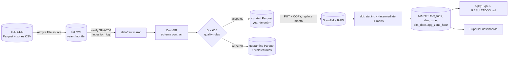

# NYC Taxi Pipeline: January 2025 vs January 2024

A reproducible batch **ELT** pipeline for the NYC TLC yellow taxi trip records. It ingests,
validates, cleans and models two months (the assigned month and the same month of the previous
year), then answers six business questions on its own dimensional model.

```
Airbyte -> AWS S3 (raw, Hive layout) -> DuckDB quality gate -> Snowflake RAW <- dbt (staging, marts)
              orchestrated by Dagster, one command: make all MES=2025-01
              observed with Prometheus + Grafana, Loki (Alloy) and Dozzle; dashboards in Superset
```

The month is a parameter everywhere. `MES=2025-01` processes 2025-01 and 2024-01.

---

## Contents

1. [Quick start](#1-quick-start)
2. [Architecture](#2-architecture)
3. [Repository layout](#3-repository-layout)
4. [Configuration and credentials](#4-configuration-and-credentials)
5. [Part 1: Ingestion](#5-part-1-ingestion-airbyte---s3)
6. [Part 2: Schema contract](#6-part-2-schema-contract)
7. [Part 3: Data quality and quarantine](#7-part-3-data-quality-and-quarantine)
8. [Part 4: Curated layer and reprocessing](#8-part-4-curated-layer-and-reprocessing)
9. [Part 5: Dimensional model and business questions](#9-part-5-dimensional-model-and-business-questions)
   - [Results: January 2025 vs January 2024](#results-january-2025-vs-january-2024)
10. [Orchestration (Dagster)](#10-orchestration-dagster)
11. [Observability (Prometheus, Grafana, Loki, Dozzle)](#11-observability)
12. [Dashboards (Superset)](#12-dashboards-superset)
13. [FinOps (Snowflake and dbt)](#13-finops-snowflake-and-dbt)
14. [Tests](#14-tests)
15. [Runtime and peak RAM](#15-runtime-and-peak-ram)
16. [Oral defense script](#16-oral-defense-script)
17. [Known limitations](#17-known-limitations)
18. [AI usage statement](#18-ai-usage-statement)

---

## 1. Quick start

Requirements: Python 3.12+, GNU make (on Windows run it from Git Bash), Docker Desktop, an AWS
account with an S3 bucket, a Snowflake account and Airbyte (`abctl`).

```bash
git clone https://github.com/bernadiaz/ParcialDataEng.git && cd ParcialDataEng
cp .env.example .env              # fill in the values (section 4)
make install                      # .venv + dependencies (PYTHON="py -3.13" to pick another interpreter)
make up                           # Grafana, Prometheus, Pushgateway, Loki, Alloy, Dozzle, Superset
make all MES=2025-01              # the whole pipeline for 2025-01 and 2024-01 (Dagster); creates the
                                  # Airbyte source/destination/connections automatically if missing
make superset-dashboards MES=2025-01
```

**Without cloud accounts** (graders, CI, laptop on a plane): the same pipeline runs end to end
locally. Ingestion downloads the files from the TLC CDN, and the warehouse is a local DuckDB file
that dbt and the questions use instead of Snowflake:

```bash
make all MES=2025-01 INGEST_MODE=direct WAREHOUSE=duckdb
```

| UI | URL | What |
|---|---|---|
| Dagster | http://localhost:3003 (`make dagster-ui`) | asset lineage, monthly partitions, runs, reconciliation check |
| Grafana | http://localhost:3002 | *Pipeline Health & Logs*, *Data Quality* |
| Superset | http://localhost:8090 | 6 business dashboards (English) |
| Dozzle | http://localhost:8081 | live container logs |
| Prometheus | http://localhost:9090 | metrics (from the Pushgateway, :9091) |

Ports bind to `127.0.0.1` and avoid 3000/3001/8088/8089, which other local stacks often use.

---

## 2. Architecture



Every row read ends in **curated** or in **quarantine**. The invariant
`rows read = accepted + quarantined` is checked on every run, and the run fails when it does not hold.

| Layer | Where | Written by |
|---|---|---|
| Raw (bronze) | `s3://<bucket>/raw/yellow/year=YYYY/month=MM/`, mirrored in `data/raw/` | Airbyte + `src/ingesta_airbyte.py` |
| Curated + quarantine (silver) | `data/curated/yellow/year=/month=/`, `data/quarantine/...` | `src/calidad.py` (DuckDB) |
| Warehouse RAW | `NYC_TAXI.RAW.YELLOW_TRIPS`, `TAXI_ZONES`, `LOAD_LOG` | `src/load_snowflake.py` |
| Staging / marts (gold) | `NYC_TAXI.STAGING` (views), `NYC_TAXI.MARTS` (tables) | dbt (`dbt_taxi/`) |

Why each tool:
- **DuckDB** is the local quality gate. It needs no cluster, handles 3.5M rows in seconds and uses
  about 1.3 GB of RAM.
- **Snowflake + dbt** build the analytical model, with tests, lineage and cost controls.
- **Airbyte** owns the cloud landing.
- **Dagster** gives partitions per month, run history and asset checks.
- **Make** stays the single entry point.

---

## 3. Repository layout

```
contracts/          yellow_schema.yaml, taxi_zone_schema.yaml, quality_rules.yaml (versioned, not in code)
airbyte/            connections/*.yaml (versioned Airbyte config, no secrets) + README_AIRBYTE.md
src/                config, ingesta_airbyte, esquema, calidad, load_snowflake, resultados,
                    orchestration (Dagster), observability, exploracion, demos
dbt_taxi/           dbt project: staging (views), intermediate (ephemeral), marts, tests, macros
sql/                q1..q6 (one query per file) + interpretations.yaml
snowflake/          setup.sql (warehouses, monitor, schemas, tags, role) + finops.sql
observability/      prometheus.yml, alloy/config.alloy, grafana provisioning + dashboards
superset/           Dockerfile, config, bootstrap_dashboards.py (dashboards as code)
tests/              pytest: quality rules, idempotency, reconciliation, schema
docker-compose.yml  observability + BI stack
Makefile            the only command you need
```

`data/` (or `DATA_DIR`) holds raw mirrors, curated, quarantine, reports, logs and the control
database. It also holds Dagster's run history (`dagster_home`) and Superset's metadata
(`superset_home`). It is gitignored. `make clean` empties it but keeps `superset_home`, so the
dashboards are not lost.

---

## 4. Configuration and credentials

Everything is read from **`.env`** (gitignored). The template is [`.env.example`](.env.example).
No credential is ever written in the code or in versioned files.

Paths in `.env` are portable, so the same file works on Windows, Linux and macOS:
- `~` is the user's home folder;
- a relative path is relative to the repository.

`src/config.py` resolves them once, before dbt, Dagster or the Snowflake connector start, and
docker compose expands `~` in its volumes. For example, `DATA_DIR=~/nyc_taxi_data` and
`SNOWFLAKE_PRIVATE_KEY_PATH=~/.snowflake/taxi_svc.p8`.

| Variable | Purpose |
|---|---|
| `WAREHOUSE` | `snowflake` (default) or `duckdb` (offline) |
| `INGEST_MODE` | `airbyte` (default) or `direct` (TLC CDN fallback) |
| `DATA_DIR` | local data folder (default `./data`). Keep it out of OneDrive/Dropbox/iCloud, because sync clients lock DuckDB files. Dagster's run history goes to `DATA_DIR/dagster_home` |
| `AWS_PROFILE`, `AWS_REGION`, `S3_BUCKET` | AWS profile (AWS Toolkit / `aws configure`); keys stay in `~/.aws` |
| `AIRBYTE_*` | API URL, client id/secret (`abctl local credentials`), workspace, S3 keys for the destination |
| `SNOWFLAKE_*` | account, service user `TAXI_SVC` with a key pair (`SNOWFLAKE_PRIVATE_KEY_PATH`), role, warehouse, database. `externalbrowser` is supported, but it only works on accounts with a SAML identity provider |
| `COST_ENV`, `COST_OWNER` | FinOps query tags |
| `GRAFANA_*`, `SUPERSET_*` | local admin passwords and the Superset service user key file |

**Snowflake, once:** run [`snowflake/setup.sql`](snowflake/setup.sql) in a Snowsight worksheet as
`ACCOUNTADMIN` **before the first load**. It creates:
- the `WH_TAXI_DEV` and `WH_TAXI_RUN` warehouses;
- the `RM_TAXI` resource monitor;
- the database with its `RAW`, `STAGING` and `MARTS` schemas;
- the cost tags;
- the `TAXI_PIPELINE` role, granted to your user;
- the **`TAXI_SVC` service user**, with a key pair.

Generate the key with `openssl` (the commands are in step 7 of the script) and paste the public key
before running that step. The loader, dbt, the questions and Superset all connect as `TAXI_SVC`.
The private key stays in `~/.snowflake`, outside the repo.

---

## 5. Part 1: Ingestion (Airbyte -> S3)

`make airbyte-sync MES=2025-01` (`src/ingesta_airbyte.py`) handles each dataset and month (and the
zone lookup once). Airbyte details are in [airbyte/README_AIRBYTE.md](airbyte/README_AIRBYTE.md).

The Airbyte objects are created **automatically** from the versioned YAML the first time they are
needed: a source, an S3 destination and a manual connection per dataset. The setup is idempotent
(objects are reused by name) and survives the slow schema discovery of the File source.

1. **Skips** when the last successful `ingestion_log` entries still match the local mirror
   (SHA-256) and S3 (size + ETag). A second run neither syncs nor downloads, and it logs
   `action=skipped`.
2. **Parametrizes** the versioned connection: the source URL `yellow_tripdata_{mes}.parquet` and
   the destination path `raw/yellow/year={year}/month={month}`.
3. **Retries** a failed Airbyte job (or download) **3 times, waiting 1 s, 2 s and 4 s**. If it
   still fails, it logs `status=error` and **exits with code 1**. A 404 (month not published yet)
   fails immediately.
4. **Verifies** the result:
   - removes leftovers of older syncs under the month prefix;
   - downloads each object to `data/raw/...` computing SHA-256, with an atomic rename so no file
     is left half written;
   - checks the Parquet row count against the job's `rowsSynced`.

`ingestion_log` (control database) has one row per file: run id, dataset, month, file, URL, S3
URI, bytes, SHA-256, rows (Parquet metadata), ETag, mode, action, Airbyte job id, attempts,
status, error and timestamp.

There are three ingestion modes:
- **`INGEST_MODE=hybrid`** (recommended and used for the delivered run) keeps Airbyte for the zone
  lookup and uses the direct path for the monthly files.
- **`INGEST_MODE=direct`** is the fallback without Airbyte. It downloads the same files from the CDN
  with the same retries, hash and log, and uploads them unmodified to the same S3 path when
  `S3_BUCKET` is set.
- **`INGEST_MODE=airbyte`** sends everything through Airbyte.

Why `hybrid` for the monthly Parquet: Airbyte's File source cannot ingest it.
- It needs more than 4Gi per job pod. With 7Gi it no longer runs out of memory.
- Even then, every attempt fails with `Object of type Timestamp is not JSON serializable`: the
  connector cannot serialize the Parquet datetime columns.

The test and the settings are in [airbyte/README_AIRBYTE.md](airbyte/README_AIRBYTE.md).

---

## 6. Part 2: Schema contract

[`contracts/yellow_schema.yaml`](contracts/yellow_schema.yaml) declares every target column with its
DuckDB type, `required`, `nullable`, `source_aliases` and the description from the TLC data
dictionary (March 18, 2025). Before anything is loaded, `src/esquema.py` compares each raw file
with the contract and writes `data/reports/schema/schema_report_yellow_<mes>.md/.json` and a row
in the control table.

- **snake_case:** a generic function plus explicit aliases. For example, `PULocationID` becomes
  `pu_location_id`, and `Airport_fee` (the file really uses a capital A) becomes `airport_fee`.
- **Both months, one table:** each month is read with the contract's names and types, so the
  curated dataset (and `RAW.YELLOW_TRIPS`) holds both with an identical schema.
- **Decision: `cbd_congestion_fee` in 2024 = NULL.** The charge did not exist before Jan 5, 2025.
  0 would mean "the trip paid no congestion fee" and would mix that with "the fee did not exist".
  The column is declared `required: false`, so it is filled with NULL when absent.
- **A required column is missing** (e.g. `trip_distance`): the run fails before loading. The
  schema report shows it.
- **A new column not in the contract** (e.g. a future `surge_fee`): it is ignored and reported as a
  warning (report, log, Grafana). The raw file keeps it untouched, so adopting it later is a contract
  change plus a reprocess. Airbyte metadata (`_airbyte_*`) is ignored on purpose.
- **A type differs from the contract:** the value is `TRY_CAST` to the contract type, and the
  report counts the values that could not be cast. This is expected with Airbyte, which can deliver
  `passenger_count` as double or timestamps as text.

---

## 7. Part 3: Data quality and quarantine

Rules live in [`contracts/quality_rules.yaml`](contracts/quality_rules.yaml): id, description,
severity, threshold, rationale and the SQL predicate. `src/calidad.py` turns them into **one DuckDB
pass**. Rule counts below are rows violating each rule; a row can violate several.

| Rule | Description | Severity | Threshold | 2024-01 | 2025-01 |
|---|---|---|---|---:|---:|
| R01 | Pickup outside the file's month | reject | year/month ≠ `--mes` | 18 | 22 |
| R02 | Dropoff ≤ pickup | reject | duration ≤ 0 s | 870 | 2,051 |
| R03 | Distance ≤ 0 or > max | reject | 100 miles | 60,430 | 91,055 |
| R04 | Negative (or missing) total amount | reject | `total_amount < 0` | 35,504 | 63,037 |
| R05 | Passenger count NULL or 0 | **warning** | NULL or 0 | 171,627 | 564,805 |
| R06 | Zone not in the lookup | reject | id ∉ zones | 0 | 0 |
| R07 | Exact duplicate (2nd+ copy) | reject | all contract columns equal | 0 | 0 |
| R08 | Tip negative or greater than the fare | warning | `tip < 0 or tip > fare` | 41,402 | 148,413 |
| R09 | **Own rule:** average speed above max | reject | 80 mph | 1,107 | 982 |
| R10 | **Own rule:** CBD fee negative or charged before Jan 5, 2025 | warning | fee < 0, or > 0 before the start | 0 | 6,954 |

| | 2024-01 | 2025-01 |
|---|---:|---:|
| Rows read | 2,964,624 | 3,475,226 |
| Accepted (curated) | 2,870,896 (96.84%) | 3,323,437 (95.63%) |
| Quarantined | 93,728 (3.16%) | 151,789 (4.37%) |
| Accepted with warning flags | 150,746 | 511,679 |
| Reconciled (read = accepted + quarantined) | yes | yes |

**Thresholds and severities** (from `make explore`; full reasoning in the YAML):
- **R03 = 100 miles.** p99 is 20 miles and p99.9 is about 29 miles; the maximum observed is
  312,722 miles. 100 miles leaves room for negotiated out-of-city trips (rate codes 4/5).
- **R05 is a warning, not a reject.** Every Flex Fare trip (`payment_type = 0`) has NULL passenger
  count, rate code and store-and-forward flag. That is 4.7% of 2024-01 but **15.5% of 2025-01**.
  Rejecting them would bias every year-over-year comparison, and no business question uses passengers.
- **R09 (own rule) = 80 mph.** It was found while exploring: trips of a few seconds with several
  miles. Either the timestamps or the distance are wrong.
- **R10 (own rule).** It comes from the 2025 schema change: 6,553 trips have a −0.75 fee
  (reversals) and 401 were charged before the toll existed. It is a warning because a trip that
  starts before midnight can enter the zone after the toll starts.
- **R07 keeps the first copy** as accepted and quarantines the rest. The rule finds no duplicates in
  these files, and a synthetic test proves it works.

**Quarantine:** `data/quarantine/yellow/year=/month=/part-0.parquet` holds one row per rejected
trip, with the contract columns, `source_file`, `source_row_number` (pointing to the untouched raw
row) and `violated_rules`. Warnings never drop a row; they go into the `quality_flags` column of
the curated data.

**Reports:** `data/reports/quality/quality_report_<mes>.md` and `.csv` (rows read, accepted,
quarantined and count per rule), plus the control tables and the Grafana *Data Quality* dashboard.

**Reconciliation:** curated and quarantine are written to temporary folders and recounted. If
`read ≠ accepted + quarantined` the step raises, exits with code 1, and the published partition
stays as it was. Dagster shows it as the failed asset check `curated_yellow_trips/reconciliation`.

**Handling of NULLs:**
- A predicate that evaluates to NULL counts as "not violated", so each rule handles NULLs
  explicitly. For example, R01 treats a NULL pickup as a violation.
- Values that fail `TRY_CAST` become NULL and are caught by the rules.
- `tip_pct` is NULL when `fare_amount ≤ 0`.
- `avg_speed_mph` is NULL when the duration is 0.

---

## 8. Part 4: Curated layer and reprocessing

- **Partitioned Parquet (Hive style):** `data/curated/yellow/year=YYYY/month=MM/part-0.parquet`
  (ZSTD), with the contract columns, lineage and `quality_flags`.
- **Derived columns** are computed in dbt (`int_trips_enriched`):
  - `duration_min`, `avg_speed_mph`;
  - `pickup_date`, `pickup_hour`, `pickup_dow` (ISO day of week);
  - `tip_pct` (tip as % of fare).
- **Enrichment:** `pu_borough`, `pu_zone`, `do_borough` and `do_zone` come from joining the zone
  lookup twice.
- **Reprocessing a month replaces only that partition:**
  - Locally, the new partition is written to `month=MM.tmp/` and swapped in only after it
    reconciles.
  - In Snowflake, `DELETE WHERE year/month` + `COPY INTO` run in **one transaction**, which rolls
    back if the loaded rows differ from the curated count.
  - In dbt, `fact_trips` and `agg_zone_hour` are incremental: a pre-hook deletes the months in
    `DBT_MONTHS` and the run appends them again.
  - dbt's `delete+insert` strategy with `unique_key=(year, month)` is not used on purpose. That key
    is not unique, so its `DELETE ... USING` joins millions of rows against millions. The demo below
    caught it.

**Demonstration** (`make demo-idempotency MES=2025-01`, offline mode on the author's machine). It
counts every layer, runs the whole pipeline again through Dagster and counts again:

| layer / partition | before rerun | after rerun | status |
|---|---:|---:|---|
| curated 2024-01 | 2,870,896 | 2,870,896 | unchanged |
| curated 2025-01 | 3,323,437 | 3,323,437 | unchanged |
| quarantine 2024-01 | 93,728 | 93,728 | unchanged |
| quarantine 2025-01 | 151,789 | 151,789 | unchanged |
| warehouse marts.agg_zone_hour (sum trips) 2024-01 | 2,870,896 | 2,870,896 | unchanged |
| warehouse marts.agg_zone_hour (sum trips) 2025-01 | 3,323,437 | 3,323,437 | unchanged |
| warehouse marts.fact_trips 2024-01 | 2,870,896 | 2,870,896 | unchanged |
| warehouse marts.fact_trips 2025-01 | 3,323,437 | 3,323,437 | unchanged |
| warehouse raw.yellow_trips 2024-01 | 2,870,896 | 2,870,896 | unchanged |
| warehouse raw.yellow_trips 2025-01 | 3,323,437 | 3,323,437 | unchanged |

The raw files were not downloaded again (`action=skipped`, same SHA-256), and the warehouse load
reports `rows_replaced` equal to `rows_loaded` for each month. That means the month was replaced,
not appended.

---

## 9. Part 5: Dimensional model and business questions

**Star schema** (dbt, schema `MARTS`):

| Table | Grain | Notes |
|---|---|---|
| `fact_trips` | one row per **accepted trip** (one row of RAW) | key `trip_key` = md5(source_file#row); FKs `pickup_date` → `dim_date`, `pu_location_id`/`do_location_id` → `dim_zone` (role-playing); measures in USD, miles, minutes; incremental by (year, month) |
| `dim_zone` | one row per **TLC LocationID** (265) | names are not unique (Corona = 56 and 57), so queries group by id; `is_airport` |
| `dim_date` | one row per **calendar day of each processed month** | ISO day of week, day name, weekend flag, `year_month` |
| `agg_zone_hour` | one row per **pickup zone × pickup date × pickup hour** with trips | trips, total revenue (sum of `total_amount`), average duration; incremental by (year, month) |

dbt runs tests on every build (34 in total):
- `unique` and `not_null` on the keys;
- `relationships` from the fact to both dimensions;
- `accepted_values` for `payment_type`;
- two singular reconciliations: `fact_trips` = RAW per month, and `agg_zone_hour` adds up to
  `fact_trips` with a unique grain.

**Questions:** `sql/q1..q6` (one query per file), run by `make questions` into
[RESULTADOS.md](RESULTADOS.md). Each answer shows its number, the query, the result table and its
interpretation from `sql/interpretations.yaml` (in Spanish). The same run rewrites the results block
below, so the README always shows the latest numbers.

### Results: January 2025 vs January 2024

<!-- RESULTADOS:START - generated by `make questions` from sql/q*.sql and sql/interpretations.yaml; do not edit by hand -->

Assigned month **2025-01** vs **2024-01**, from the dbt marts in Snowflake (run `20261115T014908Z-93f1c0`, 2026-11-15). The queries are in [RESULTADOS.md](RESULTADOS.md). The interpretations are in Spanish and come from `sql/interpretations.yaml`.

#### Q1. Top 10 pickup zones by trips in the assigned month, and their change vs the same month of the previous year.

| borough | pickup_zone | trips_assigned | trips_comparison | trips_change | trips_change_pct |
|---|---|---|---|---|---|
| Manhattan | Midtown Center | 163,866 | 140,220 | 23,646 | 16.86 |
| Manhattan | Upper East Side South | 159,330 | 140,160 | 19,170 | 13.68 |
| Manhattan | Upper East Side North | 151,616 | 134,027 | 17,589 | 13.12 |
| Queens | JFK Airport | 134,804 | 138,341 | -3,537 | -2.56 |
| Manhattan | Times Sq/Theatre District | 120,657 | 102,999 | 17,658 | 17.14 |
| Manhattan | Penn Station/Madison Sq West | 115,021 | 102,165 | 12,856 | 12.58 |
| Manhattan | Midtown East | 113,840 | 104,374 | 9,466 | 9.07 |
| Manhattan | Lincoln Square East | 107,540 | 101,847 | 5,693 | 5.59 |
| Manhattan | Upper West Side South | 93,831 | 86,532 | 7,299 | 8.44 |
| Manhattan | Midtown North | 92,702 | 83,711 | 8,991 | 10.74 |

**Interpretación:** Nueve de las diez zonas con más pickups están en Manhattan y todas crecen, entre +5,6 % (Lincoln Square East) y +17,1 % (Times Sq/Theatre District). Midtown Center lidera con 163.866 viajes (+16,9 %). JFK Airport es la única del top 10 que cae (−2,6 %), y LaGuardia, fuera del top, también baja (−1,4 %): el crecimiento de 2025 es de viajes urbanos, no de aeropuertos. La demanda además se reparte más: el top 10 concentra el 37,7 % de los pickups, frente al 39,7 % de 2024, y Brooklyn casi triplica los suyos (22.286 → 60.244), aunque sobre una base chica.

#### Q2. Hour of the day with the highest average revenue per trip (revenue = total_amount), for each of the two months.

| year | month | pickup_hour | trips | avg_revenue_per_trip |
|---|---|---|---|---|
| 2025 | 1 | 5 | 21,233 | 33.64 |
| 2024 | 1 | 5 | 17,490 | 37.54 |

**Interpretación:** La hora con mayor ingreso promedio por viaje es las 5 AM en los dos años: US$ 33,64 en 2025 y US$ 37,54 en 2024. Es una hora de poco volumen (21.233 viajes, contra 242.182 a las 18, la hora pico de demanda en ambos años). Gana porque a esa hora pesan los viajes largos al aeropuerto. En 2025 esos viajes son menos (del 25,8 % al 20,8 % de los viajes de las 5 AM) y la distancia media baja (de 6,23 a 5,71 millas), por eso el ingreso por viaje cae un 10,4 %. Ojo con el segundo puesto de 2025 (las 12, US$ 30,68): es artificial, porque lo infla un único viaje con una tarifa de US$ 863.372. Sin las tarifas mayores a US$ 500, las 12 valen US$ 25,59.

#### Q3. Share of trips with cbd_congestion_fee > 0 in the assigned month, and the 5 pickup zones with the highest share.

| scope | borough | trips | trips_with_cbd_fee | pct_with_cbd_fee |
|---|---|---|---|---|
| ALL ZONES |  | 3,323,437 | 2,192,727 | 65.98 |
| Stuy Town/Peter Cooper Village | Manhattan | 5,344 | 4,842 | 90.61 |
| Alphabet City | Manhattan | 7,110 | 6,433 | 90.48 |
| Union Sq | Manhattan | 92,363 | 83,546 | 90.45 |
| Midtown East | Manhattan | 113,840 | 102,890 | 90.38 |
| Midtown Center | Manhattan | 163,866 | 147,299 | 89.89 |

**Interpretación:** El 65,98 % de los viajes de enero 2025 pagó cbd_congestion_fee (2.192.727 de 3.323.437, siempre US$ 0,75). El porcentaje está diluido porque el peaje empezó el 5 de enero: del 1 al 4 (el 10,4 % de los viajes del mes) casi nadie lo pagó (0,12 %; esos unos 400 cobros anticipados quedan marcados por la regla R10), y desde el 5 lo paga el 73,6 %. Las 5 zonas con mayor proporción (Stuy Town/Peter Cooper Village, Alphabet City, Union Sq, Midtown East y Midtown Center, alrededor del 90 %) están todas en Manhattan, dentro de la zona de peaje. Contando solo desde el 5 de enero llegan al 97–99 %: prácticamente todo viaje que sale de ahí paga. En enero 2024 la columna no existía y quedó en NULL (no en 0), así que este indicador no tiene contra qué compararse.

#### Q4. Average tip as a percentage of the fare, by payment type (both months).

| year | month | payment_type | payment_type_name | trips | avg_tip_pct | weighted_tip_pct |
|---|---|---|---|---|---|---|
| 2025 | 1 | 0 | Flex Fare | 412,946 | 2.74 | 3.02 |
| 2025 | 1 | 1 | Credit card | 2,423,279 | 26.29 | 22.94 |
| 2025 | 1 | 2 | Cash | 367,786 | 0.00 | 0.00 |
| 2025 | 1 | 3 | No charge | 12,025 | 0.01 | 0.02 |
| 2025 | 1 | 4 | Dispute | 35,497 | 0.03 | 0.02 |
| 2024 | 1 | 0 | Flex Fare | 115,127 | 9.14 | 9.06 |
| 2024 | 1 | 1 | Credit card | 2,297,767 | 26.26 | 22.62 |
| 2024 | 1 | 2 | Cash | 422,562 | 0.00 | 0.00 |
| 2024 | 1 | 3 | No charge | 10,383 | 0.04 | 0.03 |
| 2024 | 1 | 4 | Dispute | 22,680 | 0.03 | 0.02 |

**Interpretación:** Con tarjeta de crédito la propina se mantiene estable: 26,29 % de la tarifa en 2025 frente a 26,26 % en 2024 (22,9 % y 22,6 % ponderada), y deja propina el 94–95 % de esos viajes. En efectivo da 0 % porque la TLC no registra las propinas en efectivo, no porque no se dejen. El cambio grande es Flex Fare (payment_type 0), que pasa de alrededor del 4 % a alrededor del 15 % de los viajes (115.127 → 412.946 con tarifa > 0) y cuya propina cae del 9,14 % al 2,74 %. Esos viajes llegan sin passenger_count, y por eso los warnings de la regla R05 suben del 5,8 % al 16,3 % de las filas leídas. "No charge" y "Dispute" tienen una propina cercana a 0, como es esperable.

#### Q5. Trips and average fare of trips that start or end at JFK or LaGuardia, identified by zone name.

| year | month | airport_trips | avg_fare_amount | trips_touching_jfk | trips_touching_lga |
|---|---|---|---|---|---|
| 2025 | 1 | 270,966 | 58.03 | 157,420 | 116,346 |
| 2024 | 1 | 276,027 | 55.04 | 162,026 | 117,140 |

**Interpretación:** Los viajes que empiezan o terminan en JFK o LaGuardia bajan un 1,8 % (276.027 → 270.966) mientras el total de la ciudad sube un 15,8 %, así que su peso cae del 9,6 % al 8,2 % de los viajes. La tarifa promedio sube de US$ 55,04 a US$ 58,03 (+5,4 %), pero esa suba no es real: la produce un solo viaje con fare_amount = US$ 863.372,12 (de LaGuardia a Astoria Park, 1,6 millas, pago en disputa). Excluyendo las tarifas mayores a US$ 500 en los dos años, el promedio pasa de US$ 55,01 a US$ 54,82 (−0,3 %), y la mediana baja de US$ 53,53 a US$ 52,70. La tarifa fija de JFK (RatecodeID 2) sigue en US$ 70. Ninguna regla de calidad pone un tope a la tarifa; ese hueco queda documentado como limitación.

#### Q6. Change in total trips and average fare between the assigned month and the same month of the previous year.

| trips_assigned | trips_comparison | trips_change | trips_change_pct | avg_fare_assigned | avg_fare_comparison | avg_fare_change_pct |
|---|---|---|---|---|---|---|
| 3,323,437 | 2,870,896 | 452,541 | 15.76 | 17.73 | 18.47 | -4.00 |

**Interpretación:**

- Enero 2025 tuvo 3.323.437 viajes válidos contra 2.870.896 en enero 2024: +452.541 viajes (+15,76 %). La recaudación total (total_amount) crece un 12,7 %, de US$ 78,4 M a US$ 88,3 M.
- Parte del salto es de calendario: enero 2025 tuvo 5 jueves y 5 viernes (días fuertes), y enero 2024, 5 lunes y 5 martes. Con el calendario de 2024 el crecimiento sería +14,7 %. Todos los días de la semana crecen entre +11 % y +21 %, así que el aumento es real.
- La tarifa promedio baja un 4,00 % (de US$ 18,47 a US$ 17,73); sin las tarifas mayores a US$ 500 (entre ellas, el viaje de US$ 863 mil) la baja es del 5,4 % (de US$ 18,46 a US$ 17,47). La mediana no cambia (US$ 12,80): no bajaron las tarifas, cambió la mezcla de viajes.
- Esa mezcla tiene más viajes Flex Fare, que son más baratos (US$ 14,84 contra US$ 18,22 del resto) y pasan del 4 % al 15 % de los viajes, y menos viajes a aeropuertos (del 9,6 % al 8,2 %) y de más de 10 millas (del 7,9 % al 6,9 %). Sin Flex Fare, la tarifa media casi no cambia (de US$ 18,41 a US$ 18,22).
- Calidad: la cuarentena sube del 3,16 % al 4,37 % de las filas leídas, empujada por las distancias fuera de rango (R03: del 2,0 % al 2,6 %) y por los totales negativos (R04: del 1,2 % al 1,8 %). En los dos meses se cumple la reconciliación: leídas = aceptadas + cuarentena.

#### Conclusiones

- La demanda de taxis amarillos crece con fuerza en enero 2025 (+15,8 % de viajes, +12,7 % de recaudación). El crecimiento se concentra en el núcleo de Manhattan (Midtown, Upper East Side, Union Sq), mientras los aeropuertos se estancan o bajan.
- El peaje de congestión (CBD, US$ 0,75 desde el 5 de enero) alcanza a 3 de cada 4 viajes desde que rige. Varias de las zonas que más crecen están dentro de la zona de peaje (Union Sq +24,1 %, Times Sq +17,1 %, Midtown Center +16,9 %): en este mes no se observa una caída de demanda donde se cobra. Es una correlación, no una medición de causa.
- El viaje promedio es algo más corto (3,16 contra 3,29 millas) y más barato. La baja no viene de las tarifas: la mediana sigue en US$ 12,80, y sin Flex Fare la tarifa por tramo de distancia es casi igual. Viene de la mezcla, con más Flex Fare (tarifa fija acordada por app) y menos aeropuertos y viajes largos. La propina con tarjeta, en cambio, no se mueve (alrededor del 26 %).
- Los promedios son frágiles. Un único viaje con una tarifa de US$ 863.372 cambia el signo de la tarifa media de aeropuertos y el segundo puesto de las horas, por eso se reportan también la mediana y el promedio sin atípicos. La siguiente regla de calidad a agregar es un tope de tarifa o de tarifa por milla.
- Los datos de 2025 traen cambios de formato que el pipeline absorbe sin romperse: la columna nueva cbd_congestion_fee (NULL en 2024) y el aumento de Flex Fare sin passenger_count (warning R05). Las cifras salen de los marts de dbt en Snowflake, son reproducibles con make all MES=2025-01 y los dos meses reconcilian.

<!-- RESULTADOS:END -->

---

## 10. Orchestration (Dagster)

`make all MES=2025-01` runs `src/orchestration.py`. The monthly assets use **dynamic partitions**
(`YYYY-MM`): only the processed months exist, because `make all` registers the assigned month and
its comparison month. The UI therefore shows 2/2 materialized instead of a calendar of empty months.
Assets are grouped by layer: `ingestion` → `quality` → `warehouse` → `staging` → `marts` →
`analytics`.

```
taxi_zone_lookup ─┐
raw_yellow_trips ─┴> yellow_schema_report -> curated_yellow_trips -> raw/yellow_trips ─┐
                                              (check: reconciliation)                 ├> dbt models -> resultados_md
                                        taxi_zone_lookup -> raw/taxi_zones ───────────┘
```

- `raw/yellow_trips` and `raw/taxi_zones` share their asset keys with the dbt sources, so the lineage
  continues through `stg_*`, `fact_trips`, `dim_*` and `agg_zone_hour`. Each dbt model is an asset
  (`dagster-dbt`).
- Each step is one Dagster run, recorded in `DAGSTER_HOME`. `make dagster-ui` shows the runs, the
  materialization metadata (rows read/accepted/quarantined, SHA-256, rows loaded) and the
  reconciliation check.
- Jobs for the UI: `monthly_pipeline` (partitioned), `reference_data` and `warehouse_models`.
- Every step can also run alone (`make schema`, `make quality`...), and `make all-steps` chains
  them without Dagster.

---

## 11. Observability

`make up` starts the stack defined in `docker-compose.yml`, with every image pinned:

- **Metrics:** each step pushes to the **Pushgateway**, and **Prometheus** scrapes it. The metrics
  are:
  - `nyc_taxi_step_duration_seconds`, `nyc_taxi_step_peak_rss_megabytes`, `nyc_taxi_step_success`;
  - `nyc_taxi_rows{outcome}`, `nyc_taxi_rule_violations{rule,severity}`, `nyc_taxi_reconciled`;
  - `nyc_taxi_ingested_rows/bytes`, `nyc_taxi_ingestion_skipped`;
  - `nyc_taxi_loaded_rows`, `nyc_taxi_deleted_rows`.

  Each metric has the labels `step` and `mes`. The Pushgateway groups metrics by `{job, step, mes}`.
  - A data push (rows, violations, loads) replaces its group, so reruns overwrite and do not pile up.
  - The step's run metrics (duration, RAM, success) are added with POST at the end of the step.
    POST replaces only metrics with the same name, so it never wipes the quality numbers that the
    step pushed into the same group (`tests/test_observability.py`).
  - The Pushgateway saves its metrics to a persistence file on the `pushgateway-data` volume, every
    30 s and on shutdown. Grafana keeps showing the last run after a container restart or a reboot.
- **Logs:**
  - Every log line goes to stdout and to `DATA_DIR/logs/pipeline.jsonl` as JSON (`ts`, `level`,
    `logger`, `run_id`, `msg`).
  - **Grafana Alloy** (Promtail's successor) tails that file and the stdout of every container,
    and sends both to **Loki**.
  - **Dozzle** shows container logs live.
- **Grafana** (provisioned, read-only dashboards):
  - *NYC Taxi - Pipeline Health & Logs*: status, duration and peak RAM per step, rows landed and
    loaded, log volume per level, warnings/errors and the full pipeline log.
  - *NYC Taxi - Data Quality*: reconciliation, quarantine %, rows per outcome, violations per rule
    and month.
- If the Pushgateway is down, the pipeline logs one warning and continues. Observability never
  breaks a run.

---

## 12. Dashboards (Superset)

`make superset-dashboards MES=2025-01` (`superset/bootstrap_dashboards.py`) creates the dashboards
**as code** through the Superset API. It is idempotent: objects are matched by name and updated. It
creates the database connection (Snowflake marts through the service user's key pair, or the
offline DuckDB copy), 10 virtual datasets and **6 dashboards in English**. Each one compares the
assigned month with the same month of the previous year (series colored per period):

| Dashboard | Charts |
|---|---|
| Executive Overview | trips, revenue and average fare per period (big numbers), daily trips and revenue by day of month, KPI table |
| Demand Patterns | trips by hour, revenue per trip by hour, weekday × hour heatmaps (one per period), trips by borough, duration by hour |
| Pickup Zones | top 15 pickup zones (both periods), trips change table by zone |
| Congestion Relief Zone (CBD fee) | share of trips with the fee, daily share (step on Jan 5, 2025), zones with the highest share |
| Payments & Tips | trips by payment type, average tip % by payment type, detail table, note on cash tips |
| Airports (JFK & LaGuardia) | pickups and dropoffs per airport, average fare and duration |

- **Column names.** Snowflake returns unquoted identifiers in UPPERCASE (`PERIOD`, `DAY_OF_MONTH`).
  DuckDB returns them in lowercase. The bootstrap reads each dataset's real column names from the
  API and maps every chart's columns to them, so the same chart definitions work on both
  warehouses. Without that mapping, charts fail with `Columns missing in dataset: ['period']`.
- **Persistence.** Superset's metadata lives in a host folder, `DATA_DIR/superset_home`
  (`superset.db`), not in a Docker volume. That covers dashboards, charts, datasets and the
  connection. It survives container restarts and re-creation, `docker compose down -v`, volume
  prunes, a Docker Desktop reset and a reboot. If it is ever lost, run
  `make superset-dashboards MES=2025-01` to rebuild it all.

---

## 13. FinOps (Snowflake and dbt)

**Warehouses:**
- `WH_TAXI_DEV` and `WH_TAXI_RUN` are X-Small, with 60 s auto-suspend and auto-resume.
- The resource monitor `RM_TAXI` allows 10 credits per month: it notifies at 75% and suspends at 100%.
- Ad-hoc BI never runs on RAW or on a large warehouse.

**Layers and materializations:**
- RAW is loaded only with the accepted rows.
- STAGING is a **transient schema** (no Fail-safe) with views.
- Intermediate models are **ephemeral**.
- `fact_trips` and `agg_zone_hour` are **incremental by (year, month)**: a pre-hook deletes the
  processed months and the run appends them, so there is never a full refresh. This also avoids
  dbt's `delete+insert` on a non-unique key, whose many-to-many delete join would burn credits.
- Dimensions are small tables.
- There are no clustering keys (about 6M rows do not need them) and no `SELECT *` in the marts.

**Loading:**
- The internal stage files are removed after each load.
- `PUT` sends ZSTD Parquet (about 50 MB per month).

**Attribution:**
- Every query carries the tag `project=nyc_taxi;env=dev|exam;owner=...;step=...`.
- The warehouses and the database carry `PROJECT` / `ENV` / `OWNER` object tags.

**Measuring:** `make finops` runs [`snowflake/finops.sql`](snowflake/finops.sql) as the service
user. It reports:
- **Credits per warehouse and day**, from `SNOWFLAKE.ACCOUNT_USAGE.WAREHOUSE_METERING_HISTORY`.
  `TAXI_PIPELINE` can read it through `IMPORTED PRIVILEGES` on the `SNOWFLAKE` database. The view
  lags up to about 3 hours, so a run that just finished may not show yet. The
  `INFORMATION_SCHEMA` version would need the account-wide `MONITOR USAGE` privilege, and without
  it it returns no rows.
- **Queries, elapsed time and GB scanned per pipeline step**, read from the query tag (finished
  queries only).
- **Storage per table.** Staging models are views, so they use no storage.

| Item | Value |
|---|---|
| Warehouse size | X-Small (1 credit/hour, billed per second, 60 s minimum) |
| Estimated cost of one `make all` | the dbt build took 74 s in DuckDB. On an X-Small, loads + dbt + questions should take a few minutes of active warehouse, **about 0.05-0.1 credits per run** |
| Measured credits / dbt time on Snowflake | *fill in with `make finops` after the first Snowflake run* |

---

## 14. Tests

`make test` runs 40 tests on synthetic data, with no network or cloud account needed. Besides the
groups below:
- `tests/test_resultados.py` checks the interpretation formatting, that the README results block is
  replaced only between its markers, and that `sql/interpretations.yaml` answers every question.
- `tests/test_config.py` checks the portable paths (`~`, relative and absolute).
- `tests/test_observability.py` checks that a step's run metrics do not wipe its quality metrics in
  the Pushgateway.
- `tests/test_demos.py` checks that `make finops` splits its SQL script correctly, even with `;`
  inside comments and strings.
- **Quality rules** (`tests/test_calidad.py`): ten synthetic rows, each built to hit one rule. The
  test checks curated vs quarantine, the flags, the duplicate handling and the report. A second
  test checks that a 2024 file gets a NULL CBD fee without triggering R10.
- **Idempotency** (`tests/test_idempotencia.py`):
  - direct download twice = one HTTP request;
  - mocked Airbyte + S3 (moto) twice = one sync;
  - a changed mirror forces a re-download;
  - a month ingested locally, without S3, is synced to S3 once Airbyte is configured;
  - network errors retry with waits of 1-2-4 s and end with exit code 1, while a 404 does not
    retry;
  - a quality rerun replaces only its partition;
  - a warehouse reload replaces, not appends.
- **Reconciliation** (`tests/test_reconciliacion.py`):
  - unbalanced counts raise;
  - a failed reconciliation keeps the published partition and exits with code 1;
  - the Snowflake load rolls back when COPY loads the wrong count.
- **Schema** (`tests/test_esquema.py`): snake_case, a missing optional column becomes NULL, a
  missing required column fails, a new column is ignored, and type differences are cast and counted.

---

## 15. Runtime and peak RAM

Measured on the author's laptop (Intel Core i7-13620H, 10 cores, 16 GB RAM, Windows 11), with
`make all MES=2025-01 INGEST_MODE=direct WAREHOUSE=duckdb`, two months and 6.4M raw rows, through
Dagster. Every number is also in `run_metrics` and in Grafana.

| step | month | first run (s) | rerun (s) | peak RAM of the process (MB) |
|---|---|---:|---:|---:|
| ingest-zones | static | 10.1 | 5.0 | 247 |
| ingest | 2025-01 | 11.3 | 5.2 | 279 |
| schema | 2025-01 | 9.2 | 1.2 | 358 |
| quality | 2025-01 | 39.9 | 34.0 | 1,288 |
| load-duckdb | 2025-01 | 17.1 | 22.3 | 1,288 |
| ingest | 2024-01 | 9.9 | 4.7 | 1,288 |
| schema | 2024-01 | 1.9 | 3.1 | 1,288 |
| quality | 2024-01 | 23.1 | 17.3 | 1,288 |
| load-duckdb | 2024-01 | 20.0 | 9.3 | 1,650 |
| load-zones-duckdb | static | 8.8 | 3.2 | 1,650 |
| dbt | 2025-01,2024-01 | 73.6 | 57.6 | 1,650 |
| questions | 2025-01 | 0.8 | 1.1 | 1,650 |
| **total (steps)** | | **226** | **164** | **peak 1,650** |

Notes on the table:
- **Peak RAM** is the running peak of the single process that executes every step, so the last
  rows show the maximum of the whole run: **1.65 GB**, well under the 8 GB budget. DuckDB is capped
  with `DUCKDB_MEMORY_LIMIT=2GB` and spills to disk.
- **Wall-clock time** of `make all` was **6 min 25 s** on the first run (downloads included) and
  **4 min 36 s** on the rerun, where the raw files were skipped by hash. The difference with the
  sum of the steps is Dagster's per-run overhead: one run per month plus zones and dbt.
- **Snowflake times** (PUT/COPY, dbt on an X-Small) are not measured here. `make finops` reports
  them after the first cloud run.

---

## 16. Oral defense script

```bash
make up && make all MES=2025-01            # 1. full pipeline (Dagster UI: make dagster-ui)
make demo-idempotency MES=2025-01          # 2. run again: every count unchanged, raw skipped by hash
make quality-report MES=2025-01            # 3. quality report
make show-quarantine MES=2025-01           #    one quarantined row per rule, with its source row
```

Then show:
- **Grafana:** *Data Quality* and *Pipeline Health & Logs*.
- **Dozzle:** live container logs.
- **Superset:** the 6 dashboards.
- **Snowflake:** `RAW.LOAD_LOG`, one row per load with the rows replaced and loaded.

---

## 17. Known limitations

- **Cloud credentials:** the plan's cloud path (Airbyte, S3, Snowflake) needs your own accounts.
  `INGEST_MODE=direct WAREHOUSE=duckdb` runs everything locally. The Airbyte wrapper has unit
  tests against a mocked Airbyte API and mocked S3 (moto). It also ran against a local Airbyte
  (`abctl`), where the monthly Parquet files use `INGEST_MODE=hybrid` (see `airbyte/README_AIRBYTE.md`).
- **Airbyte types:** Airbyte's File source reads Parquet with pandas and may change types. The
  contract casts them back and reports the values that could not be cast.
- **Total amount:** `total_amount` differs from the sum of its components by ±$2.50 (the congestion
  surcharge) in about 26% of 2024-01 rows and 32% of 2025-01 rows. It is vendor reporting, and it
  is documented but not corrected.
- **Cash tips:** they are not recorded by the TLC, so tip analyses by payment type are only
  meaningful for card payments.
- **No fare cap:** no rule bounds `fare_amount`. One 2025-01 trip (LaGuardia → Astoria Park,
  1.6 mi, dispute) has a fare of $863,372.12. It passes every rule and skews averages: the average
  airport fare in Q5, the second-best hour in Q2 and the average fare in Q6. The interpretations
  therefore also report medians and averages without fares above $500. The next rule to add is a
  cap on the fare or on the fare per mile.
- **Flex Fare trips** (15.5% of 2025-01) miss passenger count and rate code. They are kept and
  flagged with R05.
- **TLC accuracy:** the TLC does not guarantee the accuracy of the data, so the thresholds are
  conservative and documented.
- **Scope:** only the assigned month and its comparison month. The code is parametrized by month,
  but a backfill of every month is out of scope.

---

## 18. AI usage statement

AI assistants were used during this project and every line was reviewed by the author:

- **Claude Code (Anthropic):** generated most of the implementation in this repository from the
  project plan and the exam statement. That includes the Python modules, the dbt project, the SQL
  questions, the tests, the Docker/observability configuration, the Superset dashboards-as-code and
  this README. It also profiled the January files to propose the thresholds.
- **Cursor:** used for the project plan (`Plan_Pipeline_NYC_Taxi`).

At the author's request, Claude Code also drafted the interpretations and conclusions in
`sql/interpretations.yaml` (shown in RESULTADOS.md and in the results section of this README). It
based them on the measured results and on control queries over `marts.fact_trips`. The quality rule
severities, the thresholds and the interpretations are the author's responsibility. The author
reviews them and defends them in the oral exam.
